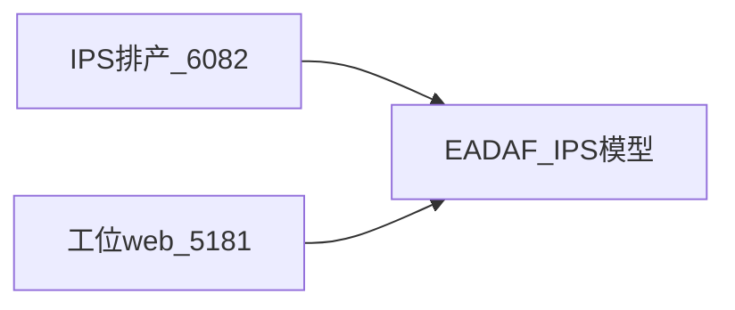

# FMMS 数据并入 IPS，admin 改名为 web

## 评估

IPS 已经覆盖排产和大部分主数据：工卡 `IPS/production/WorkCard`、工位 `IPS/master/Workstation`、检验项和检验记录、委外 `WorkCardOutsourcing`、测量设备 `MeasurementEquipment`、WBS。字段是 camelCase，表在 IPS 自己的物化结果上。

FMMS 现在是另一套：`fmms/production/WorkCard` 等 18 个实体，snake_case，再加一个钩子把 IPS 工卡抄进 FMMS 工卡。[admin/backend/src/routes/ipsHook.routes.ts](admin/backend/src/routes/ipsHook.routes.ts) 就是这个复制口。两套工卡字段几乎对不上，继续维护会永远有映射和漂移。

因此：

- 数据模型和已发布 API 只留 IPS 这一套。工位执行还缺的能力，补到 IPS 实体上，然后重新物化、重新发布 API。
- 不再把工卡抄到 `fmms/production/WorkCard`。派工就是 IPS 工卡状态变成可执行；工位系统直接改这张工卡。
- 应用仍然两个。IPS 应用给排产端，FMMS 应用给工位端（SSO、采集回调、`IPS_HOOK_TOKEN` 不再需要）。FMMS 应用的数据权限改为允许调用 IPS 的 API 服务。
- `fmms:*` 实体和 API 在工位流程切过去并核对之后再停用，不在第一步删除。

工位端现在用、IPS 还没有或不够用的，要补进 IPS，而不是在 FMMS 里留影子表：

- 工卡执行：进度、合格/不合格件数、接受人。`acceptedAt` / `repairStartedAt` / `repairFinishedAt` / `workstationId` 已有，优先复用。
- 工卡零件清单（分拣、修理、收发都按零件操作）。IPS 有物料和齐套要求，没有「这张工卡上的这件零件做到哪一步」。
- 线边库、出入库、形迹盘槽位、报废、现场呼叫、AGV 任务。
- 检验记录上的照片对象编号；测量设备上的连接参数（串口、地址）。能加在 `InspectionRecord`、`MeasurementEquipment` 上就不新建同名实体。

采集管道 `fmms/digital_measure` 改挂到 IPS 的检验记录上，或新建 `IPS/...` 管道。工位回调地址可以不变，BFF 转发的目标要换成新管道。

## 1. 先改 IPS 模型和 API

在 EADAF 上改 `IPS:*` 实体，不改 `fmms:*`。物化后发布对应 Find/Create/Update。把这些服务加入 FMMS 应用的可访问数据范围，否则工位应用令牌会 401。

IPS 仓库 [packages/shared/src/types.ts](/Volumes/dev/SDQLJ_IPS/packages/shared/src/types.ts) 和 [routes.ts](/Volumes/dev/SDQLJ_IPS/packages/shared/src/routes.ts) 同步新字段和新实体。排产页面只在自己用到的字段上改，不把工位界面做进 IPS。

## 2. 工位端改为调用 IPS

[packages/shared/src/constants.ts](packages/shared/src/constants.ts) 的 `EADAF_ROUTES` 从 `fmms/...` 改成 `IPS/...`。对照关系：

- 工卡、工位、WBS、检验项、检验记录：用 IPS 已有路径，读写改成 camelCase。
- 委外：`WorkCardOutsourcing`，不再写 `fmms/service/OutsourceOrder`。
- 测量设备：`MeasurementEquipment`。
- 零件、线边库、形迹盘、报废、呼叫、AGV：用第 1 步补上的 IPS 实体。

[admin/backend/src/eadaf/repositories.ts](admin/backend/src/eadaf/repositories.ts) 和 [op.routes.ts](admin/backend/src/routes/op.routes.ts) 按新字段改。前端工位页只跟着 BFF 的返回字段改，不直接拼 EADAF 路径。

删掉 [ipsHook.routes.ts](admin/backend/src/routes/ipsHook.routes.ts) 和 `IPS_HOOK_TOKEN`。没有第二张工卡，就不需要复制钩子。

种子数据改打 IPS 的 Create。已有 `fmms_*` 表里的开发数据不迁移，切过去后用新种子。

## 3. admin 改名为 web

只改本仓库目录和包名，端口不变：BFF `5180`，页面 `5181`。

- 目录 `admin/backend`、`admin/frontend` 改为 `web/backend`、`web/frontend`。
- [pnpm-workspace.yaml](pnpm-workspace.yaml) 和工作区脚本里的 `admin/` 路径一起改。
- 包名 `@fmms/backend`、`@fmms/frontend` 改为 `@fmms/web-bff`、`@fmms/web`。
- 文档和注释里的 `admin/backend`、`admin/frontend` 改成新路径。`5181/OPWeb` 仍是工位页，不另做管理端。

EADAF 管理台仍是 `http://localhost:29527`，IPS 排产页仍是 `http://localhost:6082`。
