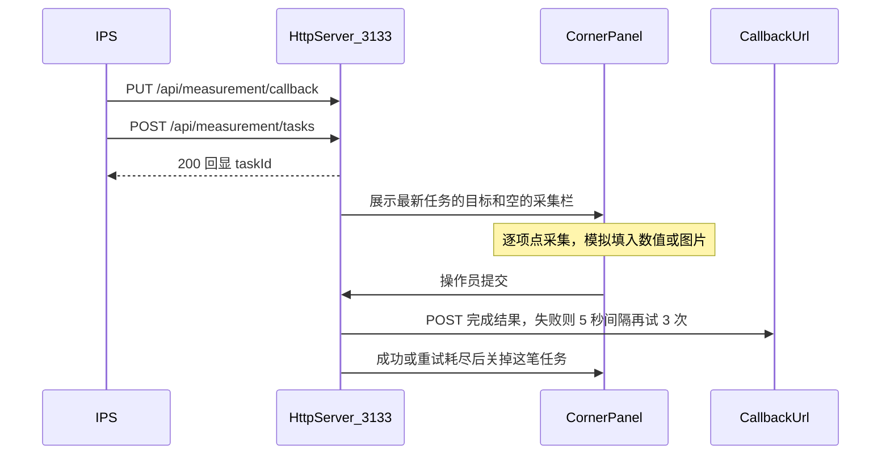

# Windows 7 测量适配程序

现有 [app-workstation-client](app-workstation-client) 里的 Electron 双屏工位客户端保持不动。新程序放在仓库根目录 [measurement-exe](measurement-exe)，与 IPS 文档一致：独立进程、端口 **3133**、不经过工位业务客户端。

运行目标是 Windows 7 SP1 及以上（含 64 位 Win7 到 Win11）。界面用 Win32，不用 Electron、NW.js、WebView2、Qt。HTTP 入站用单头文件 [cpp-httplib](https://github.com/yhirose/cpp-httplib)，JSON 用 [nlohmann/json](https://github.com/nlohmann/json)，出站回调用系统自带的 WinHTTP（Win7 上 http/https 都可用）。编译宏 `_WIN32_WINNT=0x0601`，清单声明从 Windows 7 起支持；不调用 Win8+ API。

## 行为

接口按 [面向IPS的设备测量接口.md](docs/面向IPS的设备测量接口_mdscape/面向IPS的设备测量接口.md) 实现，参数表按 [标准测量参数.md](docs/标准测量参数.md) 写死在程序里，`standardRevision` 为 `2026-10-10`。五种设备、全部 `code` 都视为本机可采集（模拟驱动），因此正常请求不会返回 `DEVICE_TYPE_UNSUPPORTED` / `PARAM_UNSUPPORTED`。

- `PUT/GET /api/measurement/callback`：本机只留一个回调地址。空地址返回 `CALLBACK_URL_EMPTY`。地址写入 exe 旁的 `callback.json`，重启后仍在。不探测能否连通。
- `POST /api/measurement/tasks`：校验 `taskId`、回调已注册、`deviceType`、`params` 非空、`code` 属于该设备且不重复。同一 `deviceType` 已有未完成任务返回 `DEVICE_BUSY`；内存里已有相同 `taskId` 返回 `TASK_DUPLICATED`。任务只放内存，不落盘。
- `GET /api/measurement/health`：`status=ok` 与版本号。不写调试日志。
- `GET /api/measurement/logs?limit=`：默认 100、范围 1–1000，非法返回 `LIMIT_OUT_OF_RANGE`。内存环形缓冲最多 1000 条，新的在前。日志不含测量值和图片。进程退出后日志清空。
- 回调：`results` 顺序和长度与请求 `params` 一致，`requirement` 与 `context` 原样带回。HTTP `2xx` 算送达；否则间隔 5 秒再试 3 次。四次都失败则丢掉任务并记 `callback_failed`。本地确认超时（默认 30 分钟，可在 exe 旁 `config.json` 的 `confirmTimeoutSeconds` 修改）未提交则回调 `failed` / `TIMEOUT`。

右下角面板（置顶、不占任务栏，工作区右下角，约 420 像素宽）：

- 无任务时显示「等待测量任务」。有任务时显示**最新接受**的那一笔：设备中文名、`taskId`、`context` 原文、每一项的名称、单位、`requirement` 原文、当前采集值。多种设备各有一笔未完成任务时，面板默认跟最新一笔，并可用下拉切换。
- **采集**：该项尚无值时，用模拟数据填入。数字在 `requirement.nominal` 附近微扰，否则用固定示例值；字符串用简短中文示例（如观测结论「无异常」）；图片填一张内置的极小 JPEG（Base64，无 `data:` 前缀）。每次采集数值略有变化，便于看出重测生效。
- **重测一项**：清掉该项并立刻再模拟采集一次。其他项不动。
- **清除全部重新测试**：清掉本任务全部已采集值，不自动填新值，任务仍占用该设备（IPS 再发起会得到 `DEVICE_BUSY`）。操作员再逐项采集。
- **提交测量结果**：全部项都有值才可点。提交后组 `status=completed` 回调。回调结束（成功或重试耗尽）后从内存删除任务，该设备可以接下一次请求。

托盘图标用于显示/隐藏面板和退出。关掉面板不停止 3133 监听。

## 源码布局

全部在仓库根目录 `measurement-exe/` 下，不放进 `app-workstation-client`。

- [measurement-exe/CMakeLists.txt](measurement-exe/CMakeLists.txt)：C++17，x64，静态链接运行库，生成 `measurement-adapter.exe`
- `measurement-exe/third_party/httplib.h`、`measurement-exe/third_party/json.hpp`：两个单头文件，无 vcpkg
- `measurement-exe/src/standard.*`：设备与参数目录
- `measurement-exe/src/http_server.*`：五条路由与错误体 `{code, message}`
- `measurement-exe/src/tasks.*`：内存任务、互斥、超时
- `measurement-exe/src/callback.*`：WinHTTP POST 与重试
- `measurement-exe/src/logs.*`：1000 条环形日志
- `measurement-exe/src/panel.*`：Win32 面板与托盘
- `measurement-exe/src/mock_collect.*`：按 `valueType` 生成示例值
- `measurement-exe/src/main.cpp`：Winsock、HTTP 线程、消息循环
- `measurement-exe/tests/run-tests.ps1`：自动测试脚本，不是说明文档

不新增说明文档，也不改现有 Electron 的 `package.json`。

正式运行不开放测试接口。仅当环境变量 `MEASUREMENT_AUTOTEST=1` 时，同一进程额外接受下列路径，供脚本驱动面板上的同一套动作；未设置时这些路径返回 404，IPS 接口不变。

- `POST /api/measurement/test/collect`：`{taskId, code}`，等同面板「采集」
- `POST /api/measurement/test/retest`：`{taskId, code}`，等同「重测一项」
- `POST /api/measurement/test/clear`：`{taskId}`，等同「清除全部重新测试」
- `POST /api/measurement/test/submit`：`{taskId}`，等同「提交测量结果」
- `GET /api/measurement/test/task?taskId=`：返回该项是否已采集，供断言

测试可用环境变量缩短等待，正式默认值不变：`MEASUREMENT_CONFIRM_TIMEOUT_SECONDS` 覆盖确认超时，`MEASUREMENT_CALLBACK_RETRY_MS` 覆盖回调重试间隔（正式仍是 5 秒、再试 3 次）。

## 自行安装编译环境

执行时不等待人工安装。先探测，缺什么再装什么。

1. 用 `cmake --version` 与 `vswhere` 查找已有 CMake 和 Visual Studio 的 C++ 工具集（含 Build Tools）。两者都在则直接用。
2. 缺少 CMake 时执行 `winget install --id Kitware.CMake -e --accept-package-agreements --accept-source-agreements`。装完后把 CMake 的 `bin` 加进当前进程的 `PATH`，不改用户或系统环境变量的永久配置。
3. 缺少 MSVC 时静默安装 VS 2022 Build Tools，只加工位桌面所需的 C++ 工具集：`winget install --id Microsoft.VisualStudio.2022.BuildTools -e --accept-package-agreements --accept-source-agreements --override "--quiet --wait --norestart --add Microsoft.VisualStudio.Workload.VCTools --includeRecommended"`。这一步体积大、耗时长，装完用 `vswhere` 定位 `vcvars64.bat` 再编译。安装失败或需要交互提权时，改用 `winget` 安装 LLVM MinGW（`MartinStorsjo.LLVM-MinGW` 或已缓存的等价包），用 Ninja 生成 Win7 可运行的静态链接程序，不因此停下来提问。
4. 下载 `httplib.h` 与 `json.hpp` 到 `measurement-exe/third_party/`。直连 GitHub 失败时，按本机规则为当前进程设置 `http_proxy` / `https_proxy` 为 `http://127.0.0.1:7897` 再重试，不改 git config。
5. 配置与编译：`cmake -S measurement-exe -B measurement-exe/build -A x64`（MinGW 时改用 Ninja），然后 `cmake --build measurement-exe/build --config Release`。产物为 `measurement-adapter.exe`。`/MT` 静态运行库，`_WIN32_WINNT=0x0601`。
6. 不把程序安装到 Program Files，不注册开机启动，不加防火墙规则。自动测试只访问 `127.0.0.1`。本机是当前 Windows，没有 Win7 虚拟机时不声称已在 Win7 上跑过，只保证编译目标是 Win7 API 且不调用 Win8 以后的接口。

## 自动测试

编译成功后立刻运行 `powershell -NoProfile -ExecutionPolicy Bypass -File measurement-exe/tests/run-tests.ps1`。脚本自己启动适配程序和本机回调接收端，结束时关掉它们。全程不点击面板。任一步失败则脚本以非 0 退出，修好后再跑，直到退出码为 0。

脚本覆盖：

- 健康检查返回 `status=ok` 且 `standardRevision=2026-10-10`，且这次请求不增加日志条数。
- 未注册回调时发起测量返回 400 `CALLBACK_NOT_REGISTERED`。
- 注册回调后 `GET` 读回同一地址；空 `callbackUrl` 返回 400 `CALLBACK_URL_EMPTY`。
- 发起手持式三坐标三项（含 `requirement` 与 `context`）返回 200，并回显同一个 `taskId`。
- 缺 `taskId`、未知 `deviceType`、空 `params`、未知 `code`、重复 `code` 均返回 400 及文档中的对应错误码。
- 同一设备再发起一笔返回 409 `DEVICE_BUSY`；另一设备类型可以同时接受。内存中已有的 `taskId` 再发返回 409 `TASK_DUPLICATED`。
- `limit` 缺省为 100；`0`、`1001`、非整数返回 400 `LIMIT_OUT_OF_RANGE`。
- 自动测试接口：逐项采集后，`GET` 任务能看到三项都有值；对其中一项重测后，该项数值变化、其余两项不变；清除全部后三项都空，且该设备仍然 `DEVICE_BUSY`；再采集齐后提交。
- 提交后，本机回调接收端收到一次 `status=completed` 的 POST：`results` 与请求等长且顺序相同，`context` 与 `requirement` 原样，`standardRevision` 为 `2026-10-10`，图片项是带 `mimeType`、`fileName`、`contentBase64` 的数组。回调 `2xx` 之后该 `taskId` 从内存消失，同一设备可以再接受新任务。日志里有 `accepted` 与 `completed`，且没有完整测量值。
- 回调端先连续返回非 2xx：在缩短后的重试间隔下会再次 POST，正文与第一次相同；重试耗尽后任务被丢掉，日志为 `callback_failed`。
- 将确认超时设为 1 秒且不提交：收到 `status=failed`、`error.code=TIMEOUT`，随后任务被删除。

内窥镜或拍照的 `image` 项至少在一条用例里采集并出现在回调里。脚本把失败步骤的 HTTP 状态、错误码和响应正文打到标准输出。
