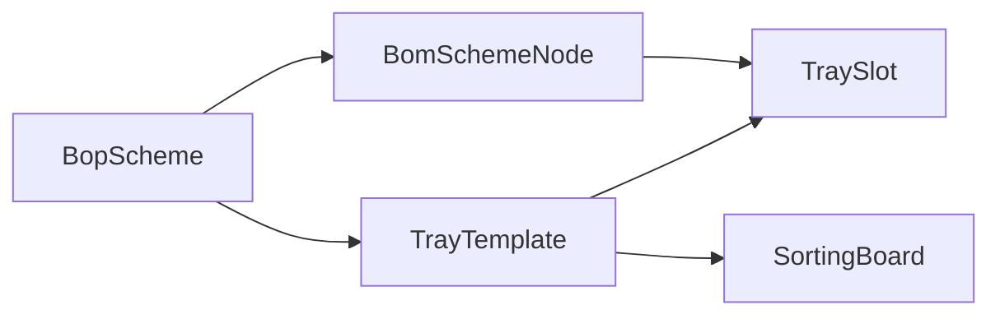

# 分拣可视化引导

## 口径

维修方案用 IPS 已有的 `BopScheme`（`/craft/bop`）。物料没有单独的分类表，父子在该方案关联的 BOM（`BomSchemeNode`）上。

- **物料 Class**：该 BOM 里挂有子件的节点。没有父子时，提供一项「整单」，把全部节点当作待分拣物料。
- **物料 item**：Class 下的子件物料。`quantity` 为 N 时生成 N 个槽，每个槽一件，各自画热区。
- 热区用相对图片的矩形（0–1 的 x、y、宽、高），点选和齐套都按槽，不按「一个物料一个格子再显示 3/5」。
- 工位只加载 `status=published` 的模版。工卡能解析到 `BopInstance.bopSchemeId` 时按方案取模版；种子工卡没有真实方案时，退回该工位类型下已发布的分拣模版。
- 物料主数据没有图片和 3D。预览列展示编号、名称、第几件；没有图片或模型就不显示那一块。

## 1. 补 IPS 形迹盘字段

现行 `IPS/logistics/TrayTemplate` 只有 `templateCode`、`templateName`、`workstationType`；`TraySlot` 只有 `templateId`、`partCode`、`slotStatus`、`sortOrder`。已发布 SQL 打在 `public` 表上，`SELECT *`，加列后不用改 SQL，但要同时改实体和物理表。

在 EADAF 上给这两个实体追加字段（先读出全部字段再整表保存，避免覆盖掉原字段），并 `ALTER` 对应的 `public` 表：

- 模版：`photoObjectId`、`bopSchemeId`、`materialClassId`、`status`（`draft` / `published`）
- 槽位：`materialId`、`instanceNo`、`slotCode`、`hotZone`（JSON 文本）、`required`

同步 [packages/shared/src/types.ts](/Volumes/dev/SDQLJ_GJXL/IPS/packages/shared/src/types.ts)。`fmms` 那套旧字段不再新建。

## 2. IPS「高级产线业务」

菜单在 [frontend/src/routes/config.ts](/Volumes/dev/SDQLJ_GJXL/IPS/frontend/src/routes/config.ts) 的「基础配置」之前增加一组，图标登记到 [frontend/src/constants/menu.tsx](/Volumes/dev/SDQLJ_GJXL/IPS/frontend/src/constants/menu.tsx)，路由写进 [frontend/src/routes.tsx](/Volumes/dev/SDQLJ_GJXL/IPS/frontend/src/routes.tsx)：

- `/line` → 分拣可视化引导管理
- `/line/sorting-guide` 列表
- `/line/sorting-guide/:id` 编辑

定制功能单独放目录，不塞进工艺管理或基础配置：

- 前端 [frontend/src/advanced-line/sorting-guide/](/Volumes/dev/SDQLJ_GJXL/IPS/frontend/src/advanced-line/sorting-guide/)
- 后端 [backend/src/advanced-line/](/Volumes/dev/SDQLJ_GJXL/IPS/backend/src/advanced-line/)，在 [backend/src/app.ts](/Volumes/dev/SDQLJ_GJXL/IPS/backend/src/app.ts) 挂到 `/api/ips`
- `TrayTemplate` / `TraySlot` 补进 [backend/src/eadaf/entities.ts](/Volumes/dev/SDQLJ_GJXL/IPS/backend/src/eadaf/entities.ts)，列表查询才能走现有 CRUD

管理页：

- 列表：编码、名称、维修方案、物料 Class、草稿/已发布、示意图缩略图
- 编辑：选已发布维修方案，再选物料 Class；上传俯视图（BFF 调已有的 `uploadObject`，只存 `photoObjectId`）
- 按 Class 子件数量生成槽位。右侧槽位列表，左侧在图上拖出热区，一槽一热区
- 保存草稿、发布。发布后工位才使用

## 3. 工位副屏按文档操作

改 [web/frontend/src/pages/op/secondary/SortingBoard.tsx](/Volumes/dev/SDQLJ_GJXL/web/frontend/src/pages/op/secondary/SortingBoard.tsx) 和 BFF 的托盘映射 [web/backend/src/eadaf/ipsMap.ts](/Volumes/dev/SDQLJ_GJXL/web/backend/src/eadaf/ipsMap.ts)：

- `GET /api/op/tray-templates?card_id=` 按工卡的 `bopInstanceId` → `bopSchemeId` 找已发布模版
- 底图用已有的 `GET /api/op/storage/:objectId/preview`，槽位按 `hotZone` 叠在图上
- 顶部「行迹盘 / 表格」可同时打开：只开一个就全屏，两个都开就左右并排
- 点槽位或表格行只打开预览，不立刻记有料。确认后该槽 `slotStatus=occupied`。另一按钮在表格行和热区之间对位闪烁
- 必填槽都 occupied 才算齐套，再提交现有工卡。AGV 沿用现有申请入口，不新做调度
- 去掉现在按零件清单铺 CSS 格子、点击就加进度的做法
