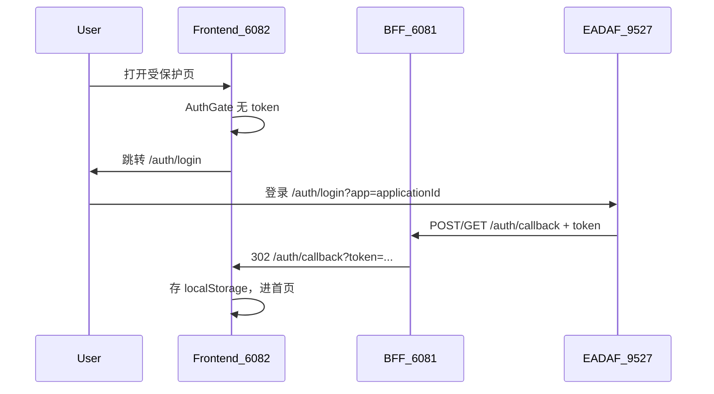

# IPS 系统 EADAF 接入骨架

## 目标与边界

- 创建独立前后端工程（非 monorepo），复用 [SDQLJ_GJXL/admin/backend](/Volumes/dev/SDQLJ_GJXL/admin/backend) 的 SSO/BFF 模式，注意： /Volumes/dev/SDQLJ_GJXL/admin/backend/src/config 、 /Volumes/dev/SDQLJ_GJXL/admin/backend/src/eadaf、/Volumes/dev/SDQLJ_GJXL/admin/backend/src/middleware/auth.ts 、 /Volumes/dev/SDQLJ_GJXL/admin/backend/.env.development（稍微修改） 可以直接复制过来用。
- **不做**排产业务功能；登录后首页仅显示文字「已登录的」。
- 不引入 `@fmms/shared`；SSO 用户类型本地内联。

## 端口与凭证


| 项              | 值                                                                  |
| -------------- | ------------------------------------------------------------------ |
| BFF            | `6081`（`SSO_CALLBACK_URL=http://localhost:6081/auth/callback`）     |
| 前端             | `6082`                                                             |
| EADAF          | `http://localhost:9527`                                            |
| app code       | `IPS`                                                              |
| application_id | `10000000-0001-4000-8000-000000000005`                             |
| app_secret     | `2d15cd49543cddea2580c21614a8169519e2c20b45bb1e3ada0ba1996e722862` |
| SSO_JWT_SALT   | `dev-sso-salt-2026`（与本地 FMMS 一致）                                   |


## SSO 流程




## 目录结构

```
SDQLJ_IPS/
  backend/          # Express BFF（tsx watch）
  frontend/         # Vite + React + antd
  docs/             # 已有，不动
```

## 后端（精简自 FMMS BFF）

从参考项目裁剪，**只保留认证相关**，去掉 `op.routes` / WebSocket / seed：

- `package.json`：`express`、`cors`、`dotenv`、`jsonwebtoken`、`tsx`、`typescript`；脚本 `dev` / `build` / `start`
- `[src/config/env.ts](/Volumes/dev/SDQLJ_GJXL/admin/backend/src/config/env.ts)` → 变量改为 `IPS_*`：
  - `IPS_APPLICATION_ID` / `IPS_APP_SECRET` / `IPS_APP_CODE`
  - `BFF_PORT=6081`、`BFF_CORS_ORIGIN=http://localhost:6082`、`FRONTEND_URL=http://localhost:6082`
  - `SSO_CALLBACK_URL=http://localhost:6081/auth/callback`
- `[src/routes/auth.routes.ts](/Volumes/dev/SDQLJ_GJXL/admin/backend/src/routes/auth.routes.ts)`：完整拷贝逻辑（`/sso-config`、`POST|GET /callback` 302 到前端、`/check`、`/me`、`/logout`）
- `[src/middleware/auth.ts](/Volumes/dev/SDQLJ_GJXL/admin/backend/src/middleware/auth.ts)`：用户 JWT 校验
- `[src/eadaf/EADAFClient.ts](/Volumes/dev/SDQLJ_GJXL/admin/backend/src/eadaf/EADAFClient.ts)`：精简为 **仅 token 获取/缓存**（启动时探测连通性；后续业务再扩展 find/create）
- `src/app.ts` + `src/server.ts`：挂载 `/auth`、`/health`
- `.env.development`（含密钥）、`.env.example`（密钥留空）、`.gitignore`

## 前端（React + antd + Vite）

对齐 FMMS auth 层，业务页替换为空白页：

- 依赖：`react`、`react-dom`、`react-router-dom`、`antd`、`@ant-design/icons`、`vite`、`@vitejs/plugin-react`
- `vite.config.ts`：port `6082`；代理 `/auth/check|me|logout|sso-config` → `6081`（**不**代理前端页路由 `/auth/callback`、`/auth/login`）
- Auth：`auth.ts` / `LoginPage` / `AuthCallback` / `AuthGate`（token key 改为 `ips_*`；登录成功回跳 `/`）
- `HomePage`：居中展示「已登录的」；包在 `AuthGate` 内
- 路由：`/auth/login`、`/auth/callback`、`/` → Home；未匹配 → `/`
- `.env.development`：`VITE_SSO_EADAF_FRONTEND`、`VITE_SSO_APPLICATION_ID`

## 不做什么

- 不实现排产/WBS 等业务接口与页面
- 不写 README / 说明文档（按你的约定）
- 不改动 `docs/` 下已有需求文档

