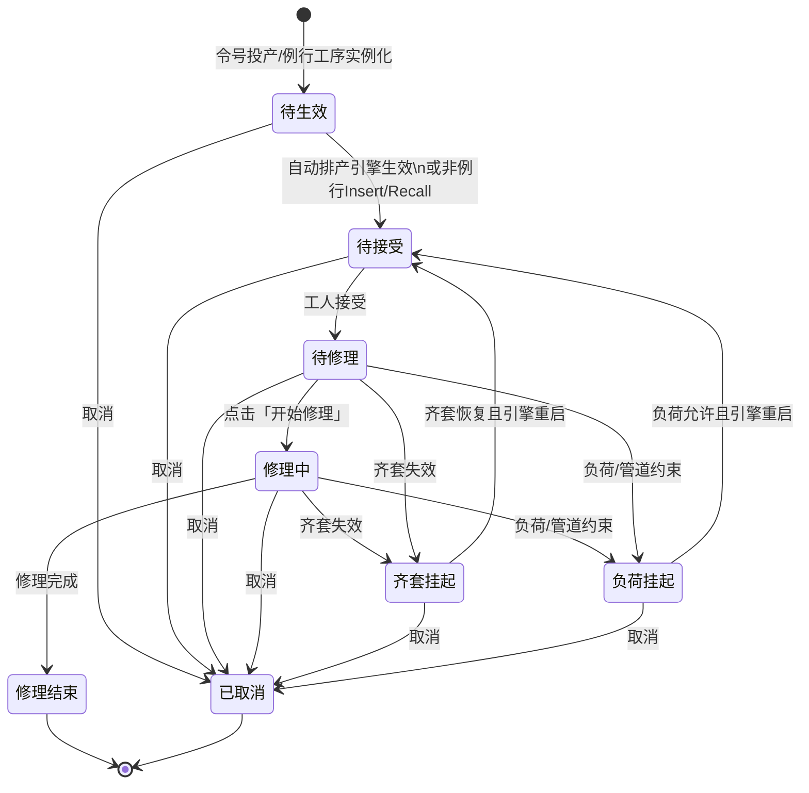
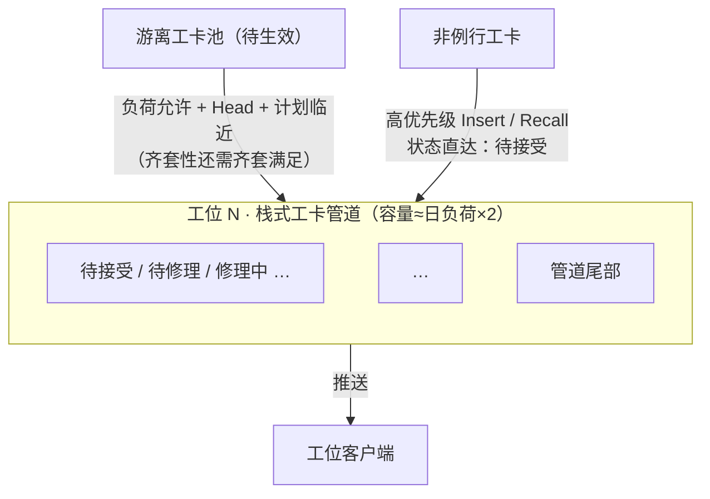

# 起落架修理车间智能排产模块 需求分析与功能架构

> 口径对齐依据：《起落架修理车间数字化业务方案（标准版）》（`车间通用业务描述.md`）。  
> 排产对象以**车间令号 → 维修方案/BOP实例 → 工卡/工卡任务**为主链路；工卡为排产与现场执行的最小单元。

---

## 一、需求分析

### 1.1 业务背景与现状

#### 1.1.1 业务背景
客户为大飞机起落架专业维修厂商。维修业务属于典型的**多品种、小批量、高不确定性柔性制造**，过程中存在返工、委外、换件、齐套等待等可变环节，无法按标准流水线或脉动线一次排死全流程。

#### 1.1.2 现有系统现状
总厂 MES 可下发粗粒度生产任务，但无法支撑精准到工序/工位的详细排产；现场仍依赖人工经验编排，响应慢、误差大。

#### 1.1.3 与标准业务方案对齐的对象口径
| 对象 | 排产相关含义 |
|------|----------------|
| 车间令号 | 车间生产组织与单台计划的最小单元；一个令号对应一套单台计划 |
| 修理方式 | 大修 / 检修 / 检测 / 油封 / 排故；投产时选定 |
| 维修方案 / BOP | 装备×修理方式对应的工艺流程；BOP 为其结构化 DAG 载体 |
| 工序 | 可独立发布、报工的最小工艺单元；例行工序投产时实例化为工卡 |
| 工步 | 依附工序；不单独排产/报工；检验点控制工序内放行 |
| 工卡 | 工序实例化执行凭证（1 工序 : 1 工卡）；排产与工位作业的最小对象 |
| 工卡任务 | 与工卡 1:1 绑定，承载计划时间与派工信息 |
| 单台计划 / WBS | 令号内全部工卡任务按 BOP 拓扑组织的集合 |

#### 1.1.4 排产下沉层级（执行视角）
- **令号 / 单台计划层**：投产与计划起止、整体交付约束。
- **区站 / 工位层**：负荷与栈式工卡管道的承载单元（与车间 20 个工作区站对齐）。
- **工卡层**：排产最小对象；精确到**日期 + 上午/下午（0.5 天）**。
- **齐套 / 资源层**：齐套性工卡的生效与挂起约束。

#### 1.1.5 工卡分类（生效条件）
1. **齐套性工卡**：生效除负荷外，还需满足配置的齐套条件（人/机/料等）；齐套变化可触发挂起与重启。
2. **非齐套性工卡**：不依赖齐套校验，**仅按工位负荷**自动生效。
3. **例行工卡**：来自维修方案标准例行工序，投产批量生成，初始为游离「待生效」。
4. **非例行工卡**：异常追加 / 临时组织 / 插单等；可更高优先级 **Insert / Recall** 进入工位栈式管道，状态可直接为「待接受」。

### 1.2 核心业务痛点
1. 粗粒度令号无法直接指导工位作业，缺少工卡级可执行计划。
2. 全流程一次排死易因返工、委外、齐套失效；需「预排计划时间」与「执行生效」分离。
3. 齐套判断滞后，易出现工位等料或料等人。
4. 工位负荷波动大，剩余产能无法自动吃掉临近的游离工卡。
5. 非例行 / 紧急工卡缺少规范的插队与召回机制。

### 1.3 核心业务诉求
1. **令号投产即生成游离工卡池**（待生效），并按工时规则预排到上午/下午。
2. **计划与生效分离**：待生效仅代表默认计划时间，不绑定准确工人；生效后才推送工位客户端。
3. **自动排产引擎**驱动：按工位栈式管道、日负荷 2 倍容量、计划临近度、齐套变化，自动生效 / 挂起 / 重启。
4. **非例行高优先级 Insert/Recall**，直达「待接受」。
5. 工卡状态机清晰可追溯，支持可视化与人工干预。

---

## 二、令号投产与工卡预排（计划侧）

### 2.1 投产主流程
一个**车间令号**投产时：

1. 选择**修理方式**，进而匹配/选择**维修方案（BOP 方案）**。
2. 补充**计划投产起止日期**（令号级计划窗口）。
3. 按维修方案中的**例行工序**实例化，生成对应**工卡（及工卡任务）**。
4. 此时工卡处于**游离**状态：已挂默认计划时段，但**未绑定准确执行工人**；状态为 **「待生效」**。
5. 工卡之间保留 BOP 工序级 **DAG** 前后置关系，形成待生效 DAG 线路。

### 2.2 游离工卡默认计划时间算法
每张工卡预排到具体**日期**，并精确到**上午或下午**，依据：

| 输入 | 说明 |
|------|------|
| 令号计划起止日期 | 排程窗口上/下界 |
| 工卡配置标准工时 | 工序/工卡模板上的标准时长 |
| 历史完成时间中位数 | 同类工卡（同机型/同修理方式/同工序）实际完成时长的中位数 |
| BOP DAG 前后置 | 后置工卡不得早于前置工卡计划完成时段 |
| 排期开关「是否包含周六」 | 关闭时跳过周六 |
| 排期开关「是否包含周日」 | 关闭时跳过周日；**默认关闭（周日不可排）** |

**选用工时**：以「配置标准工时」与「历史中位数」综合（实现上可配置优先级：有足够样本时优先中位数，否则用标准工时）。

**时段粒度**：0.5 天（上午 / 下午）。一张工卡可占用连续多个 0.5 天时段，直至覆盖其选用工时。预排与自动顺延时，仅占用「可排工作日」上的上午/下午时段（由周六/周日开关共同决定）。

### 2.3 排期参数配置
| 参数 | 默认 | 含义 |
|------|------|------|
| 是否包含周六 | 可配（建议默认关闭或按现场习惯） | 预排与自动顺延时是否占用周六时段 |
| 是否包含周日 | **关闭** | 预排与自动顺延时是否占用周日时段；关闭则周日不可排 |
| 班次定义 | 上午 / 下午 | 起止时刻（用于客户端展示与负荷切分） |
| 工位日负荷基准 | 按工位配置 | 每工位每个可排工作日的标准可排工时 |
| 栈式管道容量系数 | **2** | 工位同时可容纳的已生效+在制工卡工时上限 = 日负荷 × 系数 |
| 自动生效前瞻窗口 | 按现场配置 | 游离工卡计划时间临近多少个 0.5 天内可参与自动生效 |

#### 2.3.1 周末可排规则
- **周六、周日相互独立配置**，可出现：仅工作日、工作日+周六、工作日+周日、或含完整周末。
- 两个开关均关闭时，仅周一至周五参与预排、顺延与“计划临近”计算。
- 开关变更后，已「待生效」工卡的默认计划时段应按新规则重算或批量顺延（需留痕）；已生效及之后状态的工卡不自动改历史计划，仅影响后续顺延。

#### 2.3.2 挂起时管道名额（固定自动释放）
工卡进入 **齐套挂起 / 负荷挂起** 后，**自动释放**其在工位栈式管道中的占用名额（不设开关）：
- 挂起工卡**不再计入**管道容量；空出名额后引擎可立即补入其他待生效或可重启工卡。
- 挂起工卡逻辑上仍归属原工位，便于条件恢复后重启。
- 重启为「待接受」时重新占用名额；若当时管道已满，则保持挂起或转入 **负荷挂起**，待有名额后再重启。

---

## 三、工卡状态机（执行侧）

### 3.1 状态定义

| 状态 | 说明 |
|------|------|
| **待生效** | 投产生成后的游离态；有默认计划时段，未推送工位，未绑定准确工人 |
| **待接受** | 已生效并推送工位客户端，等待操作员/工人接受（含非例行 Insert/Recall 直达、齐套恢复后重启） |
| **待修理** | 工人已接受，尚未点击开始修理 |
| **修理中** | 工人点击「开始修理」后作业中 |
| **齐套挂起** | 因齐套不满足被暂停（曾进入执行链路后）；进入后**自动释放**管道名额 |
| **负荷挂起** | 因工位负荷/管道容量约束被暂停；进入后**自动释放**管道名额 |
| **修理结束** | 本工卡修理作业完成（含必要检验放行后的完工） |
| **已取消** | 工卡取消，不再参与排产与执行 |

> 业务表述「已生效『待接受』」对应状态机中的 **待接受**（生效动作完成的标志即进入该状态）。

### 3.2 状态流转

### 3.3 DAG Head 生效规则
在维修方案对应的 **「待生效」DAG 线路**中，仅当某工卡成为当前可开工的 **Head**（全部强制前置工卡已「修理结束」，或无前置）时，才允许在合理时机被引擎处理为 **「待接受」**。

- 并行分支可同时存在多个 Head。
- 非 Head 的待生效工卡即使计划时间已临近，也不得抢先生效（除非人工特批干预，需留痕）。

---

## 四、自动排产引擎

### 4.1 引擎定位
后台持续运行的调度核心：根据**工位在制情况、栈式工卡管道容量、游离工卡默认计划临近度、齐套变化、优先级**，自动将工卡在「待生效 / 待接受 / 挂起」之间迁移，并把已生效工卡推送到工位客户端。

### 4.2 工位「栈式工卡管道」模型
- 每个工位维护一条**栈式（可插队）工卡管道**：容纳已推送至该工位、尚未修理结束的工卡序列。
- **同时可处理量**通常按 **日负荷的 2 倍** 计量（以工时或 0.5 天折算后的管道容量）。
- 管道内顺序默认按计划时段与优先级排列；**非例行工卡**允许高优先级 **Insert（插入）** 与 **Recall（召回至管道有效位置）**。
- **管道占用统计**：计入「待接受、待修理、修理中」工卡工时；「齐套挂起 / 负荷挂起」**不计入**（挂起即自动释放名额，见 2.3.2）。

### 4.3 引擎核心策略

#### （1）基于在制与管道容量的负荷控制
- 实时统计各工位管道占用：修理中、待修理、待接受（挂起工卡不计入）。
- 当管道占用 **&lt; 日负荷×2** 且存在可生效候选时，继续自动生效补入。
- 超过容量则停止补入；必要时将低优先级或不可继续执行的工卡置为 **负荷挂起**（挂起后自动释放名额，供其他工卡补入）。

#### （2）非例行工卡优先 Insert / Recall
- 非例行工卡可配置更高优先级。
- 允许插入管道指定位置或召回至工人可立即处理的位置。
- **状态直接进入「待接受」**（不经过长时间游离待生效，或短暂待生效后立即生效）。
- 插队导致管道超容时，顺延或挂起低优先级例行工卡，并回写其默认计划时段。

#### （3）按「工位负荷 + 游离工卡默认计划临近」自动生效
- 候选条件（例行 / 齐套性）：
  1. 状态 = 待生效；
  2. 为所属 DAG 的当前 Head（或并行 Head 之一）；
  3. 默认计划时段进入前瞻窗口（临近）；
  4. 目标工位管道未超容；
  5. 齐套性工卡：齐套校验通过。
- 生效动作：待生效 → **待接受**，写入工位管道，**自动推送工位客户端**。

#### （4）齐套变化自动挂起 / 重启
- 齐套失效：处于待接受 / 待修理 / 修理中的齐套性工卡 → **齐套挂起**，并**自动释放**管道名额。
- 齐套恢复：引擎将工卡重启为 **待接受**（重新推送客户端）；若当时管道已满，则保持挂起或转 **负荷挂起** 直至有名额；重启成功后重新占用管道名额。

#### （5）非齐套工卡仅按负荷生效
- 非齐套性工卡**不校验齐套**；只要满足 Head（如适用）、计划临近（可配置是否放宽）与**工位负荷/管道容量**，即可自动生效为待接受。

#### （6）委外与齐套的关系（非整链挂起）
- **委外是工卡内操作**：在某一张工卡的执行过程中发起委外（发出协作件/委外工序内容），不意味着本工卡后续全部工步、更不意味着 DAG 上后续**所有**工卡一律挂起。
- 本工卡可按工艺继续完成其不依赖该委外件的部分，并在满足完工条件时正常「修理结束」（若工艺要求本卡必须等委外返回才能报完工，则仅本卡等待，仍不牵连无关后继卡）。
- **仅**后续某张（或某几张）工卡，其齐套条件显式依赖「该委外件已返回并被重新接收/入库」时，才会在齐套校验上等待；在委外未结束、委外件未重新接受前，这些依赖工卡可保持「待生效」或进入「齐套挂起」，**其余不依赖该委外件的工卡照常排产与生效**。
- 委外结束且委外件完成重新接受后，系统更新齐套状态，自动唤醒上述依赖工卡（待生效可参与生效，齐套挂起可重启为待接受）。

### 4.4 引擎输入 / 输出摘要

| 输入 | 输出 |
|------|------|
| 工位在制与管道占用 | 工卡状态变更（生效/挂起/重启） |
| 日负荷与容量系数（默认×2） | 工位管道队列更新 |
| 游离工卡默认计划时段 | 工位客户端推送消息 |
| 齐套状态事件 | 计划时段顺延 / 负荷重算 |
| 非例行优先级与 Insert/Recall 指令 | 插队后的影响工卡清单 |

---

## 五、智能排产模块功能架构

### 5.1 模块定位
本模块聚焦**令号投产后的工卡预排、自动生效、工位管道调度与执行状态闭环**，向上承接车间令号/维修方案实例化结果，向下驱动工位端工卡接受与修理。

### 5.2 功能单元总览
1. 排产基础数据与规则配置  
2. 令号投产与游离工卡预排  
3. 自动排产引擎（核心）  
4. 齐套校验与挂起/重启  
5. 工位负荷与栈式管道管理  
6. 非例行优先级与 Insert/Recall  
7. 排产可视化监控  
8. 排产效能与工时中位数沉淀  

### 5.3 详细功能说明

#### 5.3.1 排产基础数据与规则配置

| 功能点 | 功能描述 |
|--------|----------|
| 维修方案 / 工序工时配置 | 维护例行工序对应工卡标准工时、齐套性标记、目标区站/工位 |
| 历史工时中位数 | 按机型×修理方式×工序统计完成时长中位数，供预排使用 |
| 齐套规则配置 | 齐套性工卡的人/机/料校验维度与规则 |
| 排期参数 | 是否包含周六、是否包含周日、上午/下午班次、前瞻窗口、管道容量系数（默认 2）；挂起固定自动释放管道名额 |
| 优先级档位 | 例行 / 非例行 / 紧急插单等权重 |

#### 5.3.2 令号投产与游离工卡预排

| 功能点 | 功能描述 |
|--------|----------|
| 投产向导 | 选修理方式 → 选维修方案 → 填计划起止日期 → 生成例行工卡 |
| 游离工卡生成 | 状态「待生效」；保留 DAG；不绑定准确工人 |
| 默认计划排程 | 按标准工时+历史中位数，排到日期+上午/下午；遵守「是否包含周六 / 是否包含周日」 |
| 人工调整预排 | 允许调度员拖拽调整待生效工卡的计划时段，留痕 |

#### 5.3.3 自动排产引擎（核心）

| 功能点 | 功能描述 |
|--------|----------|
| Head 识别 | 基于 BOP/工卡 DAG 计算当前可生效 Head 集合 |
| 自动生效 | 负荷 + 计划临近（+ 齐套）驱动待生效 → 待接受，并推送客户端 |
| 管道补入 | 管道占用低于日负荷×2 时自动补入合格候选 |
| 自动挂起/重启 | 齐套或负荷原因挂起；条件恢复后回到待接受 |
| 计划顺延 | 挂起、超期、插队导致冲突时，自动顺延后续待生效工卡计划时段 |

#### 5.3.4 齐套校验与挂起/重启

| 功能点 | 功能描述 |
|--------|----------|
| 齐套实时校验 | 物料/工装/设备等到位状态同步 |
| 失效挂起 | 自动转入「齐套挂起」，并**自动释放**管道名额 |
| 恢复重启 | 条件满足且管道有名额时回到「待接受」并推送；无名额则等待或转负荷挂起 |
| 委外件齐套 | 委外在工卡内执行；仅依赖该委外件的后续工卡等待「委外结束 + 重新接受」后齐套响应，不整链挂起 |
| 齐套看板 | 缺项、预计齐套时间、影响工卡、委外在途件与依赖关系 |

#### 5.3.5 工位负荷与栈式管道管理

| 功能点 | 功能描述 |
|--------|----------|
| 日负荷基准 | 按工位配置标准日产能（上午/下午）；仅统计可排工作日 |
| 管道容量 | 默认同时可处理量 = 日负荷 × 2 |
| 挂起释放 | 齐套挂起/负荷挂起后**固定自动释放**管道名额，不设开关 |
| 实时负荷 | 仅统计待接受/待修理/修理中占用 |
| 负荷挂起 | 超容或资源冲突时进入「负荷挂起」，进入后自动释放名额 |

#### 5.3.6 非例行优先级与 Insert/Recall

| 功能点 | 功能描述 |
|--------|----------|
| 非例行工卡创建 | 异常追加、临时工序、排故临时 BOP 等生成非例行工卡 |
| Insert | 高优先级插入指定工位管道，状态直达「待接受」 |
| Recall | 将指定工卡召回至管道有效位置，状态「待接受」 |
| 影响评估 | 展示被挤占/顺延的例行工卡列表 |

#### 5.3.7 排产可视化监控

| 功能点 | 功能描述 |
|--------|----------|
| 令号/单台计划甘特图 | 待生效预排时段 + 已生效执行进度 |
| 工位管道视图 | 各工位栈式队列、容量占用、状态色标 |
| 工卡状态看板 | 按待生效/待接受/修理中/挂起/结束/取消筛选 |
| 齐套与负荷预警 | 超容、齐套长时挂起、交付风险 |

#### 5.3.8 排产效能与工时中位数沉淀

| 功能点 | 功能描述 |
|--------|----------|
| 实际工时采集 | 从「开始修理」到「修理结束」沉淀时长 |
| 中位数更新 | 回写预排所用历史中位数 |
| 排产偏差 | 默认计划时段 vs 实际生效/完成时段 |
| 管道利用率 | 工位产能利用、挂起损耗占比 |

---

## 六、工位端与排产闭环（摘要）

| 工人操作 | 状态变化 |
|----------|----------|
| 收到已生效工卡 | 待接受 |
| 接受 | 待修理 |
| 点击「开始修理」 | 修理中 |
| 完成修理 | 修理结束 → 触发后继 Head 可被引擎生效 |
| （系统）齐套/负荷问题 | 齐套挂起 / 负荷挂起 → 恢复后待接受 |

---

## 七、设计要点与后续可扩展项

### 7.1 本方案已固化的设计要点
1. **游离待生效 ≠ 已派工**：先有默认计划时间，再生效绑定工位管道与工人接受。  
2. **0.5 天粒度 + 周六/周日独立可配**：默认周日不可排；周六是否可排按现场开关。  
3. **DAG Head 门禁**：避免后置工卡抢先生效。  
4. **栈式管道 + 日负荷×2**：把“工位同时能盯住的在制量”产品化。  
5. **挂起自动释放管道名额**：齐套挂起/负荷挂起后固定释放占用，便于工位继续吃单；重启时再占用，管道满则继续等待。  
6. **齐套性 / 非齐套性分流**：非齐套只看负荷；齐套看负荷+齐套事件。  
7. **非例行 Insert/Recall 直达待接受**：保证异常与插单响应速度。  
8. **委外不整链挂起**：委外在工卡内执行；仅后续依赖该委外件齐套的工卡等待「委外结束并重新接受」。

### 7.2 可后续扩展（非本版阻断项，未来再升级）
1. 跨区站共享关键设备/人员的冲突校验。  
2. 检测后“修理 / 换件”分支的双预案预排。  
3. 多次返工工时衰减系数。
