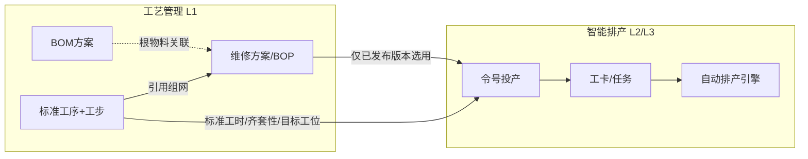
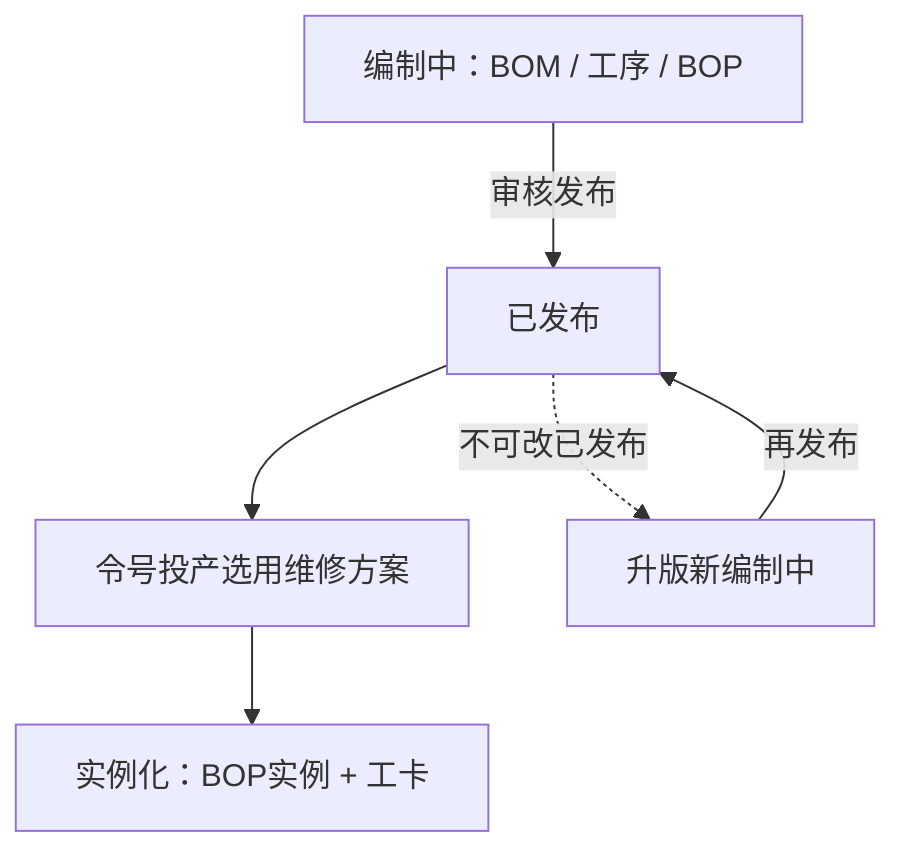

# 起落架修理车间 · 工艺管理模块 页面与功能描述

> 口径对齐依据：《起落架修理车间数字化业务方案（标准版）》（`车间通用业务和维修方案的描述.md`）。  
> 本模块覆盖 **L1 标准模板层**：BOM 方案、标准工序库（含工步）、维修方案/BOP；补齐《智能排产模块 需求分析与功能架构》未展开的工艺主数据编制与发布能力。  
> 写法对齐 `模块和导航.md`：多级导航 + 页面功能明细，可直接用于原型与前端设计。

> 剥离登录、鉴权、组织人事等非业务内容；主操作角色为**产品技术员**、**生产准备技术员**（编制/审核/发布），调度员仅只读选用结果。

---

## 一、模块定位与边界

### 1.1 定位
工艺管理负责维护投产所用的**静态工艺主数据**（可版本化、可复用、不含执行数据）。令号投产时，排产模块只**选用已发布**的维修方案/BOP，并据此实例化生成工卡；**本模块不生成工卡、不排产、不管理工位管道**。

### 1.2 对象口径（与业务方案一致）

| 对象 | 含义 |
|------|------|
| 维修方案 / BOP | 业务上等价；BOP 为维修方案的结构化 DAG 载体。一套装备 × 一种修理方式对应一套方案 |
| BOM 方案 | 产品结构模板（起落架/大部件 → 大部件/一级零件 → 零件）；BOP 根节点关联 BOM 根物料 |
| 工序 | 可独立编制、审核、发布、版本化、跨方案复用的最小工艺对象；亦是报工最小单元（在执行层） |
| 工步 | 依附工序；工序内 DAG；可标为检验点（Y/N 分支）；不可独立发布、不单独报工 |
| 修理方式 | 大修 / 检修 / 检测 / 油封 / 排故；前四类有稳定标准 BOP；排故无固定标准模板，需临时搭路线 |

### 1.3 与排产模块的边界



| 本模块负责 | 排产模块负责 |
|------------|--------------|
| BOM / 工序 / BOP 的编制、版本、发布、克隆 | 令号投产、游离工卡预排、状态机、引擎、工位管道 |
| 工序上维护标准工时、齐套性标记、目标区站/工位 | 历史工时中位数、排期参数、Insert/Recall |
| 排故临时搭路线（生成可投产的临时 BOP） | 非例行工卡插单与管道调度 |

---

## 二、多级导航结构

```
工艺管理
├── BOM方案
│   ├── BOM方案列表
│   └── BOM结构编辑
├── 标准工序库
│   ├── 工序列表
│   └── 工序详情（工步 DAG / 附属挂载）
├── 维修方案（BOP）
│   ├── 方案列表（装备 × 修理方式）
│   ├── BOP结构编辑（工序级 DAG）
│   └── 排故临时搭路线
└── 版本与发布
    └── 版本总览（编制中 / 已发布 / 已作废 + 对比与引用）
```

> 导航最多三级。各对象详情页内嵌版本操作与引用关系；「版本与发布」提供跨对象总览入口。

---

## 三、各页面功能明细

### 1. BOM方案

#### 1.1 BOM方案列表
| 功能点 | 说明 |
|--------|------|
| 方案列表 | 展示方案编码、名称、适用装备（起落架/大部件型号）、当前版本号、状态（编制中/已发布/已作废）、最近更新人/时间 |
| 筛选 | 按装备型号、状态、关键字筛选 |
| 新建 | 创建空方案或基于已有方案克隆；新建默认为「编制中」、版本号自增规则统一 |
| 打开编辑 | 进入 BOM 结构编辑（仅编制中可改结构；已发布只读，变更须升版） |
| 发布 / 作废 | 编制中 → 已发布；已发布可作废（作废后不可再被新 BOP/投产引用） |
| 被引用查看 | 查看引用该 BOM 根物料的 BOP 方案列表 |

#### 1.2 BOM结构编辑
| 功能点 | 说明 |
|--------|------|
| 树形结构 | 根节点 = 维修主体（起落架或独立修理大部件）；下级：大部件、一级零件；大部件下挂零件（大型/小型） |
| 节点维护 | 增删改节点：物料编码/名称、层级类型、大型/小型标记、数量/单位等 |
| 层级约束 | 零件不直接挂在起落架根下（仅出现在大部件之下）；一级零件可挂根下；禁止破坏既定层级语义 |
| 与转运语义对齐 | 大型/小型标记供下游清洗站选择、转运器具规则引用（本页只维护主数据，不执行转运） |
| 校验 | 保存前校验编码唯一、层级合法、根节点唯一 |
| 只读/升版 | 已发布版本只读；「基于本版升版」生成新编制中版本，拷贝整树后可改 |

---

### 2. 标准工序库

#### 2.1 工序列表
| 功能点 | 说明 |
|--------|------|
| 工序列表 | 工序编码、名称、版本、状态、标准工时、齐套性、目标区站/工位、被多少套 BOP 引用 |
| 筛选 | 按状态、区站/工位、齐套性、关键字；可筛「可被排故临时选用」类工序 |
| 新建 / 克隆 | 新建工序或克隆已有工序（含工步与附属挂载）进入编制中 |
| 发布 / 作废 | 同 BOM：仅已发布可被 BOP 引用与投产实例化；已发布不可直接改，须升版 |
| 引用关系 | 列出引用本工序（指定版本）的维修方案/BOP，便于变更影响评估 |

#### 2.2 工序详情（含工步 DAG / 附属挂载）
| 功能点 | 说明 |
|--------|------|
| 基本属性 | 编码、名称、说明、例行/非例行标记、适用修理方式标签（可多选，便于检索） |
| 排产主数据 | **标准工时**、**齐套性标记**（齐套性/非齐套性）、**目标区站/工位**；供令号投产生成工卡时继承（承接排产文档「维修方案/工序工时配置」） |
| 工步列表与 DAG | 维护工序内工步节点与有向边；默认串行，支持检验点分支；保存时做 DAG 无环校验 |
| 检验点 | 工步可标记为检验点；配置合格(Y)/不合格(N) 两条边：流向后续工步、工序完工出口、或回流至前置工步/异常出口 |
| 工步约束 | 工步不可脱离本工序独立存在、不可跨工序复用、不单独设版本；随工序版本统一变更 |
| 完工条件提示 | 界面提示：末端工步完成且强制检验点均合格，工序方可报完工（执行层规则，模板侧需结构可表达） |
| 附属挂载 · 资源 | 工装工具、设备、量具、辅料耗材 → 推荐挂**工序** |
| 附属挂载 · 物料 | 零件/一级零件/协作件（委外件）引用 → 挂**工序**；编码应能与 BOM 物料对齐以便克隆校验 |
| 附属挂载 · 文档 | 工艺附图、技术通知单、标准规范 → 工序专用挂本工序 |
| 附属挂载 · 检验规范 | 检验项目、验收标准、判定规则 → **仅挂检验点工步** |
| 附属挂载 · 工时 | 标准/准备/辅助工时 → 挂工序（精细场景可细化到工步，可选） |
| 预览 | 工步流程图预览（含检验分支着色） |

---

### 3. 维修方案（BOP）

#### 3.1 方案列表（装备 × 修理方式）
| 功能点 | 说明 |
|--------|------|
| 方案列表 | 方案编码/名称、适用装备、修理方式、关联 BOM 方案版本、BOP 版本、状态、工序节点数 |
| 匹配维度 | 按「装备 × 修理方式」检索；大修/检修/检测/油封应各有标准方案；排故不强制标准方案（见 3.3） |
| 新建 | 指定装备与修理方式、关联已发布 BOM、从空网或克隆生成编制中 BOP |
| 克隆 | 同型号/同批优先；支持跨型号、跨批号克隆；克隆后进入编制中 |
| 跨型号克隆校验 | 克隆时自动校验工序挂载物料与目标 BOM 的匹配性；不匹配工序给出预警，须工艺人员确认调整后方可发布 |
| 发布 / 作废 | 仅已发布可供「令号投产」选用；模板升版不影响已在制 BOP 实例 |
| 投产选用预览入口 | 只读预览本方案工序清单、DAG、目标工位（与排产投产向导预览一致） |

#### 3.2 BOP结构编辑（工序级 DAG）
| 功能点 | 说明 |
|--------|------|
| 根节点 | 对应本次维修主体（产品/大部件）；**关联已发布 BOM 根物料**；可挂通用文档类附属对象 |
| 引用工序 | 从标准工序库选择**已发布**工序版本挂入为节点；同一工序可被多套 BOP 引用 |
| 工序级组网 | 节点间有向边：串行、并行、分支、合流；支持异常回流边（检验不合格回流至指定前置工序） |
| DAG 校验 | 保存/发布前禁止环路；校验无孤立不可达节点（按业务规则可配置警告或阻断） |
| 节点只读展开 | 点击工序节点查看其工步摘要、标准工时、齐套性、目标工位、挂载物料（数据来自工序库，本页不直接改工序内容；需改则跳转工序详情升版） |
| 根/工序附属 | 按规范挂载资源、物料、文档；检验规范仍在工序的检验工步上维护 |
| 结构合法性 | 工步不得直接挂在 BOP 根下；工序必须挂在根下；层级不可逆 |
| 升版 | 已发布只读；升版拷贝整网与引用关系后进入编制中 |

#### 3.3 排故临时搭路线
| 功能点 | 说明 |
|--------|------|
| 适用场景 | 修理方式为**排故**（修理方式类），无固定标准 BOP 时，由工艺人员临时组织工艺路线 |
| 搭建方式 | 从工序库选用例行/非例行工序，拖拽组网形成临时 BOP；可关联令号上下文（若从投产入口唤起） |
| 与「异常追加工序」区分 | 本页处理的是**投产主基调为排故**的整件路线；常规大修过程中追加排故工序属于执行层异常处理，归排产/现场，不在此页 |
| 校验与发布 | 同样做 DAG 校验；发布或「确认可用于投产」后，供令号投产实例化（批量生成实例工序/工卡） |
| 列表 | 临时方案列表：关联装备/令号（可选）、状态、创建人、是否已投产冻结 |

---

### 4. 版本与发布

#### 4.1 版本总览
| 功能点 | 说明 |
|--------|------|
| 跨对象一览 | 统一筛选 BOM / 工序 / BOP；按状态（编制中/已发布/已作废）查看 |
| 状态流转 | 编制中 → 已发布 → 已作废；**不得直接修改已发布版本**；变更必须升版 |
| 版本对比 | 同对象相邻或任意两版本：结构差异（节点增删改）、属性差异、挂载差异 |
| 引用关系图 | 工序版本 ← 被哪些 BOP 版本引用；BOM 版本 ← 被哪些 BOP 关联 |
| 投产冻结提示 | 展示「已被在制令号实例冻结」的模板版本（只读提示，实例不回写模板） |
| 发布门禁 | 发布前检查：DAG 合法、必填主数据（如工序标准工时/目标工位）、BOP 已关联 BOM、跨克隆预警已处理 |

---

## 四、编制 → 发布 → 投产选用（主链路）



规则摘要（与业务方案第 5 章对齐，页面须落实）：
1. 仅**已发布**版本可用于投产实例化。
2. 实例冻结对应模板版本；模板升级不影响在制实例；新投产默认最新已发布版。
3. 工步无独立版本；随工序版本变更。
4. 本模块**不**创建工卡；工卡仅在投产实例化时由排产侧生成。

---

## 五、与排产模块的接口说明

| 接口点 | 工艺侧提供 | 排产侧消费 |
|--------|------------|------------|
| 投产向导 · 选方案 | 已发布 BOP 列表（装备 × 修理方式）及 DAG/工序预览 | 选定后填计划起止日期并生成待生效工卡 |
| 工卡预排工时 | 工序「标准工时」 | 与历史中位数策略合成预排时长 |
| 齐套与工位 | 工序「齐套性标记」「目标区站/工位」 | 引擎生效条件、管道归属 |
| 排故投产 | 临时搭路线产出的已确认 BOP | 按该 BOP 实例化工卡 |
| 非例行 / 异常追加 | 工序库中非例行工序主数据（可选） | 非例行工卡创建、Insert/Recall（执行在排产） |

排产导航中的「排产规则配置」「齐套规则配置」「历史工时中位数」等**仍属排产模块**；本模块只保证工序/BOP 主数据完整可引用。

---

## 六、本版不包含

1. L2/L3 页面：BOP 实例、工卡状态、单台计划 WBS、工位管道、自动排产引擎（见 `模块和导航.md`）。
2. 登录、鉴权、组织班组权限矩阵的细表。
3. 对已有 `模块和导航.md` / 排产需求文档的改写（工艺为独立导航域；总览合并另议）。
