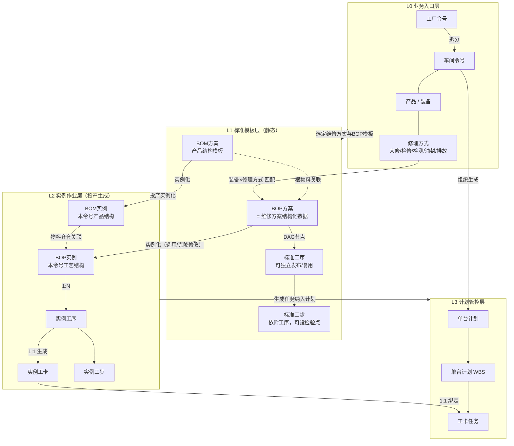
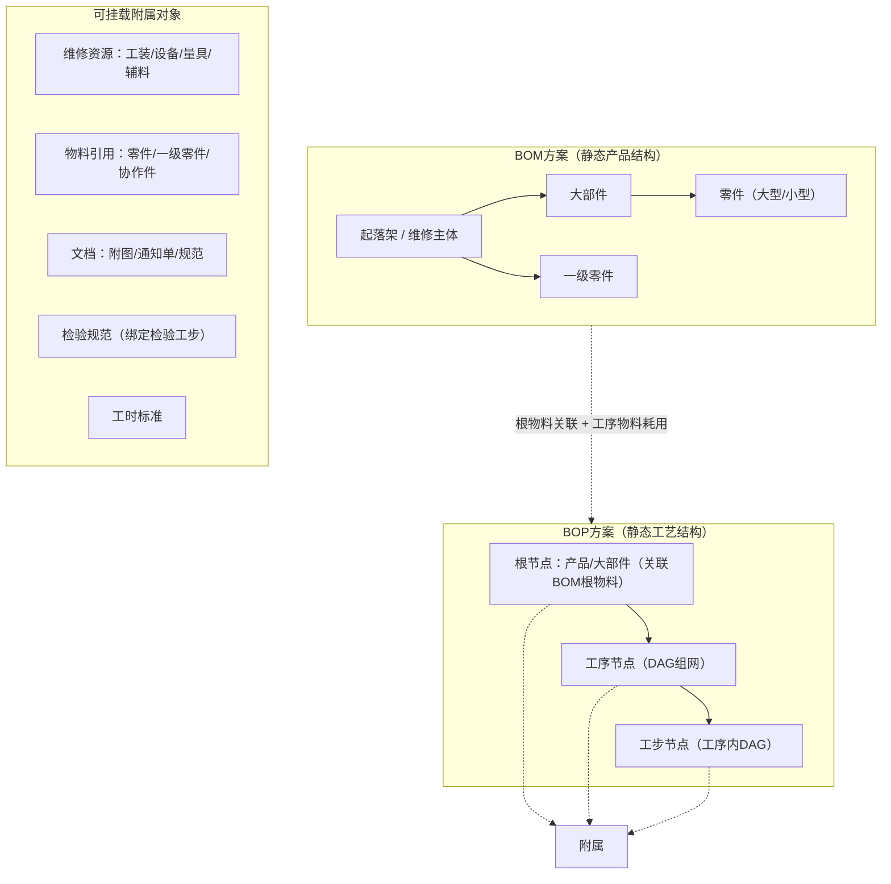
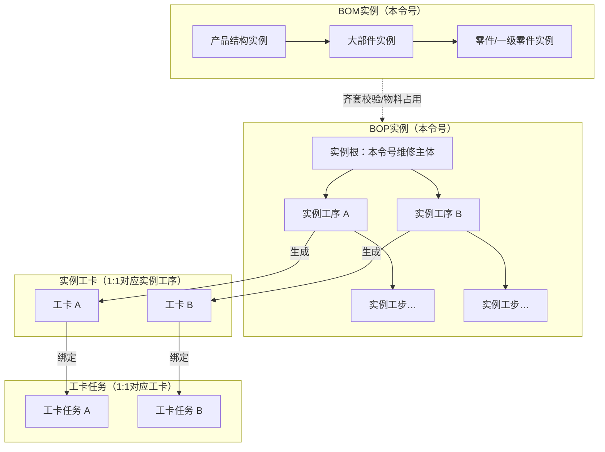
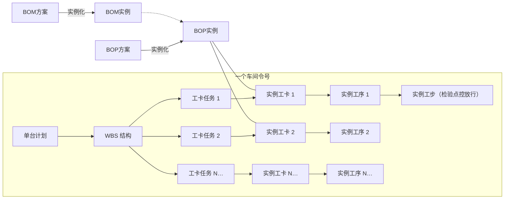

# 起落架修理车间数字化业务方案（标准版）
## 1 车间与产线的基本情况
### 1.1 组织
目前，车间共设有十四个室（班、组），分别为主任办公室、核算室、技术组、调度组（又下设器材室、配套库和成品库房）、起落架组、精密附件班、作动筒班、小附件班、机电班、燃油班、机加班、检验组、工具室和青创工作室。
车间的每一位职工必然属于且仅属于除青创工作室之外的某一个室（班、组）。青创工作室由来自于其他各室（班、组）的人员兼职组成。
PCS系统涉及到的组织有主任办公室、技术组、调度组（含器材室、配套库和成品库房）、起落架组、检验组、工具室，共六个室（班、组）。

### 1.2 人员角色
车间人员可以分为10种角色，分别为：领导、调度员、产品技术员、生产准备技术员、故检员、操作员、试验员、检验员、器材保管工和生产准备工。

### 1.3 区站划分
规划中的起落架数字化修理线被划分为20个工作区站，分别为：分解线（包括一个接收区和四个分解站）、粗洗站、清洗站、故检修理线（包括一个分拣站、两个故检站、一个修理站、一个收发站和一个备件库）、装配线（包括五个装配站）、试验区和异常处理区。
除了上述20个区站之外，起落架的修理还会涉及到若干仓储区域，包括立体库、库边区、成品区和摆盘区。

## 2 核心业务名词定义（无歧义统一版）
本章节所有术语遵循航空MRO行业通用标准，明确业务边界与数据映射关系，消除多重定义冲突。

### 2.1 产品
产品是指需要进行单独寿命控制（自身配备有履历本）的起落架结构组成部分，是维修作业的核心对象。

### 2.2 工厂令号 / 车间令号
- 工厂令号：工厂生产主管部门为每一架飞机的每一次维修生产编制的唯一生产指令编号，是车间生产任务的上游来源。
- 车间令号：工厂令号下达车间后，根据维修对象数量拆分形成的车间级生产指令编号；车间内部简称“令号”，是车间生产组织、成本核算、计划管控的最小单元。
  - 常规整机维修：1个工厂令号对应3个车间令号（对应3个起落架）。
  - 单独送修大部件：1个工厂令号对应1个车间令号。

### 2.3 维修方案 / BOP
- **维修方案**：业务层面的工艺流程定义，即针对某一类装备（起落架或大部件）、某一种修理方式，所需执行的全部作业过程的有序集合。
- **BOP（Bill of Process，工艺清单）**：维修方案的**结构化数据载体**，是用多级节点+DAG有向无环图描述的标准工艺数据模型。
- 映射关系：**一套维修方案对应一套BOP数据结构**，二者在业务上等价；BOP是维修方案在系统中的数字化表现形式。
- 复用规则：工序是BOP的最小可复用单元，同一道工序可被多个不同的维修方案（BOP）引用；不同维修方案对应的BOM结构允许存在差异。

### 2.4 工序
工序是车间独立管理的最小工艺与生产单元，是BOP结构中的核心二级节点。
- 工艺维度：工序是可独立编制、审核、发布、版本化管理、跨方案复用的最小工艺对象。
- 生产维度：工序是生产报工、工时核算、质量追溯的最小执行单元。
- 结构组成：一道工序由若干个工步按既定流转逻辑组合而成。

### 2.5 工步
工步是工序内部的最小作业颗粒度，必须依附于某一道工序存在，不可独立编制、独立发布、独立报工。
- 工步可被标记为**检验点**，作为工序内流程分支的判断节点，通过“合格/不合格”两条路径控制后续作业流向。
- 工序整体完工的前置条件：工序内末端工步执行完成，且所有强制检验点均已通过验收。

### 2.6 工作卡（工卡）
工卡是工序实例化后的执行凭证，**一道实例工序对应一张实例工卡（1:1）**，是生产现场作业、记录、签字、归档的载体。
- 静态BOP模板中不存在工卡对象，仅在投产实例化后生成。
- 委外工卡：非例行委外业务中，由受托单位执行的工序所对应的工卡，属性与厂内工卡一致，仅执行主体不同。

### 2.7 任务与单台计划
- **任务**：承载生产计划信息的最小单元，与工卡一一绑定（1张工卡对应1项工卡任务），用于排产、派工、进度跟踪与报工。
- **单台计划**：一个车间令号范围内，所有工卡任务按BOP拓扑结构组织形成的任务集合，其结构化组织形式为**单台计划WBS（工作分解结构）**。

### 2.8 修理方式
修理方式是维修方案的分类属性标签，共包含五类：大修、检修、检测、油封、排故。
- 一类装备的每一种修理方式，对应一套独立的维修方案与BOP结构。
- 大修、检修、检测、油封具备稳定的标准BOP模板；排故类修理方式无固定标准BOP，需临时组织工序搭建。
- 同一道工序可被不同修理方式的维修方案复用。
- 投产时由产品技术员确定修理方式；生产过程中支持按流程变更修理方式。

> **两类“排故”的严格区分**
> 1.  **修理方式类排故**：属于投产时选定的修理方式类型，是整台/整件维修的主基调，无固定标准BOP，需临时搭建工艺路线。
> 2.  **异常处理排故工序**：大修/检修等常规修理过程中，发现故障后追加的单道或多道工序，属于生产异常处理动作，不改变原定修理方式。

### 2.9 物料层级定义
- **大部件**：独立完成某项主要功能的起落架直接构成部件，位于起落架BOM结构第一层级，部分大部件为独立修理项。
- **一级零件**：用于连接大部件的零组件，位于起落架BOM结构第一层级。
- **零件**：构成大部件的零组件，仅出现在大部件之下，不直接隶属于起落架；按体量分为大型零件、小型零件。
  - 大型零件清洗在粗洗站执行，小型零件清洗在清洗站执行。
  - 分解后至入立库前：大型零件用行迹支架转运；分解后清洗前，小型零件/一级零件用清洗篮转运；清洗后入立库前，小型零件/一级零件用行迹盘转运。
  - 修理完成后，所有零件在立库、装配线、试验区之间统一使用行迹盘转运。

## 3 BOP标准数据结构与流转规则
BOP是维修方案的数字化载体，整体采用「**顶层根节点 + 工序级DAG网络 + 工步级DAG网络**」的三级结构化模型，同时支持附属对象按需挂载，完全匹配工业软件行业通用工艺建模标准。

### 3.1 核心层级结构（BOP主干）
BOP为带流转逻辑的结构化树图，自上而下分为三层，层级约束不可逆。

| 层级 | 对象名称 | 定位与属性 | 管理粒度 |
|------|----------|------------|----------|
| 一级 | BOP根节点（产品/大部件） | BOP的顶层入口，对应本次维修的主体对象（起落架或独立修理大部件），可关联对应BOM物料根节点 | 单套BOP唯一根节点 |
| 二级 | 工序节点 | BOP的核心执行单元，节点间通过有向边构成DAG流转网络；支持串行、并行、分支、合流逻辑 | 可独立版本化、跨方案复用 |
| 三级 | 工步节点 | 工序内部的最小作业节点，节点间通过有向边构成工序内DAG；可标记为检验点，实现Y/N分支流转 | 不可独立存在，随工序版本变更 |

### 3.2 BOP内附属关联对象
附属对象可按需挂载在BOP根节点、工序节点、工步节点上，支持多对多关联关系，行业通用挂载规范如下：
1.  **维修资源类**：工装工具、设备、量具、辅料耗材，推荐挂载至**工序节点**，按工序维度统计资源需求。
2.  **物料类**：零件、一级零件、协作件（委外件），推荐挂载至**工序节点**，对应工序作业时的物料消耗；BOP根节点关联BOM根物料，用于整体齐套校验。
3.  **文档类**：工艺附图、技术通知单、标准规范，按适用范围挂载至对应层级，通用规范挂根节点，工序专用文件挂工序节点。
4.  **检验规范类**：检验项目、验收标准、判定规则，仅挂载至**标记为检验点的工步节点**。
5.  **工时标准类**：标准工时、准备工时、辅助工时，推荐挂载至**工序节点**，精细管理场景可细化至工步。

### 3.3 DAG流转逻辑（类BPMN标准）
BOP整体遵循有向无环图（DAG）流转规则，分为两个层级的流转网络，所有分支判断均通过节点间的“有向边”实现，符合生产工艺流转通用建模标准。

1.  **工序级流转（BOP主网络）**
    - 工序节点之间通过有向边连接，支持串行、并行、分支、合流四种基础模式。
    - 前置工序全部完工并通过验收后，后置工序方可开工；并行工序可同时派工、同时作业。
    - 支持异常分支：如工序检验不合格，可通过专用边回流至前置指定工序返工。

2.  **工步级流转（工序内网络）**
    - 工步节点之间通过有向边连接，默认串行执行，可根据检验点设置分支。
    - 检验点工步为判断节点，输出两条边：
      - 合格（Y）：流向后续工步，或流向工序完工出口。
      - 不合格（N）：回流至本工序内指定前置工步返工，或流向工序异常出口。
    - 仅当工序内末端工步完成、且所有强制检验点均为合格状态时，工序才可报完工。

### 3.4 BOP核心约束规则
1.  层级不可逆：工步必须隶属于工序，工序必须挂载于BOP根节点下；不允许工步脱离工序、工序脱离BOP独立存在。
2.  复用规则：工序为独立工艺对象，可被多套BOP引用；工步随工序复用，不单独跨工序复用。
3.  生命周期：BOP、工序均支持版本化管理，发布后方可用于投产实例化；变更需走版本升级流程，不直接修改已发布版本。
4.  结构合法性：BOP整体、单道工序内的工步网络，均必须满足DAG规则，禁止出现死循环。

## 4 业务对象实例化与模块层级体系
整体分为四层架构，数据单向流转，静态模板与执行实例严格隔离，符合工业软件「模板-实例-执行」通用分层设计。

### 4.1 模块分层总览
| 层级 | 模块分类 | 核心对象 | 核心属性 |
|------|----------|----------|----------|
| L0 业务入口层 | 生产指令输入 | 工厂令号、车间令号、产品、修理方式 | 确定“修什么、怎么修、在哪个令号下修” |
| L1 标准模板层 | 静态工艺数据 | BOM方案、BOP方案、标准工序库、标准工步 | 可版本化、可复用、不含执行数据；投产的基准模板 |
| L2 实例作业层 | 投产实例数据 | BOM实例、BOP实例、实例工序、实例工步、实例工卡 | 绑定具体令号与产品，由模板实例化生成，是作业执行的载体 |
| L3 计划管控层 | 生产计划执行 | 单台计划、WBS结构、工卡任务 | 承载排产、派工、报工、进度跟踪、完工验收 |

### 4.2 实例化主链路（单向流转）

### 4.3 模板层结构：BOM方案 × BOP方案

### 4.4 实例层结构：BOP实例与工卡

### 4.5 单台计划结构（令号视角）

### 4.6 模块关系矩阵
| 从 \ 到 | BOM方案 | BOP方案 | 工序/工步 | BOM实例 | BOP实例 | 工卡 | 任务 | 单台计划 |
|---------|---------|---------|-----------|---------|---------|------|------|----------|
| 产品×修理方式 | 匹配选用 | 匹配确定 | 组装进BOP | — | — | — | — | — |
| BOM方案 | — | 根物料关联 | 物料挂接 | 实例化→ | 物料支撑 | — | — | — |
| BOP方案 | 关联物料 | — | 包含工序节点 | 协同实例化 | 实例化→ | 实例后生成 | — | — |
| 工序 | — | 被多BOP复用 | 包含工步 | — | 生成实例工序 | 1:1生成工卡 | 经工卡绑定任务 | 汇入WBS |
| 工卡 | — | 静态层不存在 | 对应实例工序 | — | 挂载于BOP实例 | — | 1:1绑定任务 | 汇入WBS |
| 任务 | — | — | — | — | — | 一对一挂接 | — | 组成单台计划 |
| 车间令号 | — | 选用/克隆模板 | — | 绑定归属 | 绑定归属 | 归属令号 | 归属令号 | 一个令号一套 |

## 5 核心业务规则与约束
### 5.1 版本管理规则
1.  **管控范围**：BOM方案、BOP方案、标准工序均纳入版本化管理，工步随工序版本统一变更，不单独设版本。
2.  **版本状态**：分为编制中、已发布、已作废三种状态；仅已发布版本可用于投产实例化。
3.  **变更规则**：静态模板修改必须走版本升级，不得直接修改已发布版本，不得反向回写执行数据。
4.  **实例冻结**：已投产的BOP实例自动冻结对应模板版本；模板升级不影响已在制实例，新投产默认使用最新版本。

### 5.2 BOP实例化规则
1.  **同型同批优先**：默认同型号、同制造批架次的产品，使用同一套标准BOP方案直接实例化。
2.  **克隆修改**：支持基于现有BOP方案克隆并局部修改，生成新的BOP方案后再实例化；支持跨型号、跨批号克隆。
3.  **跨克隆校验**：跨型号克隆BOP时，系统自动校验物料匹配性，对BOM不匹配的工序给出预警，由工艺人员确认调整。
4.  **排故类实例化**：修理方式为排故的令号，无标准BOP模板，由工艺人员从工序库中选用例行/非例行工序，临时搭建BOP后实例化。
5.  **触发机制**：BOP实例化时，自动批量生成所有实例工序、实例工步与对应实例工卡。

### 5.3 检验与流转规则
1.  **工步检验点**：标记为检验点的工步，必须由检验员确认结果后，方可触发后续流转；不合格按预设分支路径执行。
2.  **工序完工判定**：工序内所有末端工步执行完成，且所有强制检验点均为合格状态，方可进行工序报完工。
3.  **回流范围**：不合格回流支持回流至本工序内任意前置工步，或回流至BOP中指定的前置工序；回流后重新执行对应环节的检验。
4.  **工时核算**：返工回流环节按实际作业记录工时，标准工时仅作基准参考。

### 5.4 异常处理规则
1.  **修理方式变更**：生产过程中变更修理方式，需走审批流程，审批通过后基于新修理方式重新生成BOP实例，原已完工工序保留记录，未开工工序按新BOP执行。
2.  **异常追加工序**：常规修理过程中发现故障，可追加异常排故工序至BOP实例，同步生成对应工卡与任务，纳入单台计划WBS；不改变原定修理方式标签。
3.  **返工返修**：工序验收不合格，按BOP预设回流路径执行返工；无预设路径的，由技术人员指定返工工序。
4.  **委外处理**：协作件委外工序对应委外工卡，执行进度、检验结果同步回传至系统，委外完工后触发后续工序开工。

### 5.5 数据追溯规则
1.  全链路以**车间令号+产品编号**为主键，关联BOP实例、工卡、任务、检验记录、物料消耗、工时数据。
2.  支持正向追溯：从令号→BOP实例→工序→工步→检验记录；支持反向追溯：从工卡→实例工序→对应BOP模板版本→工艺编制信息。
3.  产品维修完成后，所有工卡、检验记录、工时数据统一归档至产品履历本，形成完整维修档案。