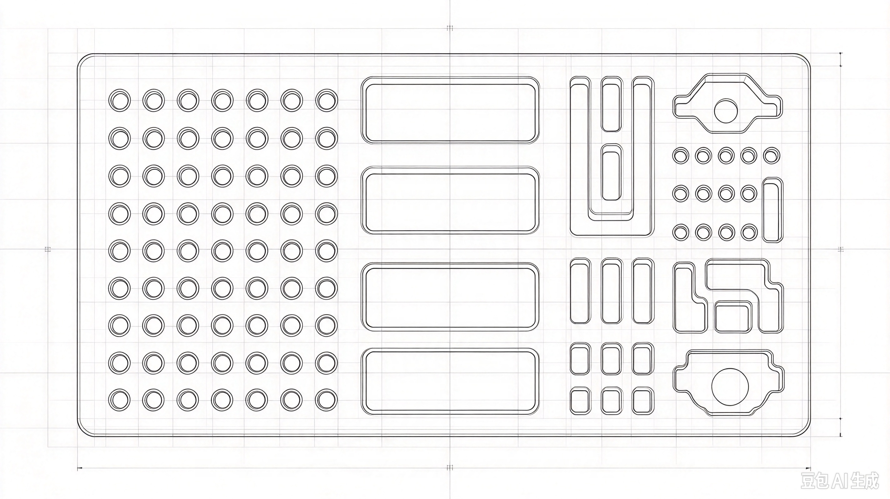
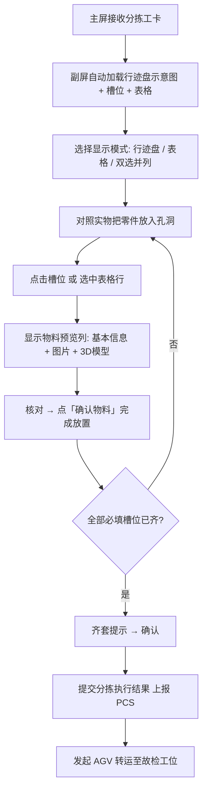

# 分拣工位「分拣示意图（行迹盘）」制作、上传、绑定与工人操作说明

> 文档目的：讲清分拣工位的「分拣示意图」（即形迹托盘 / 行迹盘俯视图）从 **制作 → 上传 → 绑定到「维修方案-行迹盘」→ 工人现场操作** 的完整链路。
>
> 适用范围：故检修理线产线执行管理系统（FMMS）分拣工位（OP01）。
>
> 目标读者：产品技术员 / 生产准备技术员（制作、上传、绑定）＋ 分拣工位操作员（现场作业）。

---

## 0. 一句话总览

分拣工位用一张 **行迹盘俯视照片（分拣示意图）** 作为分拣副屏的可视化底图，在图上把每个零件孔洞圈成「槽位」并绑定物料编码；工卡下发到分拣工位时，副屏自动显示这张图和对应槽位，工人照着图码放零件、点击标记「有料 / 无料」，系统据此做 **齐套校验** 并上报分拣结果。


---

## 1. 术语与概念

| 术语 | 含义 |
|------|------|
| 行迹盘 / 形迹托盘 | 分拣工位用于码放小零件的托盘，配套 EPE 珍珠棉 / 防静电 EVA 泡沫内衬，孔洞按零件外形定制，实现归置、防丢、可视化管理 |
| 分拣示意图 | 行迹盘的**俯视照片 / 示意图**，作为分拣副屏可视化码盘的底图（即「附件」这类图） |
| 维修方案 / BOP | 「装备 × 修理方式」对应的工艺流程（BOP 为其结构化载体），分拣工位按方案执行零件清点与码盘 |
| TrayTemplate（形迹托盘模版） | 行迹盘的数字化台账，**一张示意图对应一个模版**；唯一标识为托盘编码（非托盘实例） |
| TraySlot（模版槽位） | 示意图上每个孔洞的形状定义与物料绑定，运行时记录「有料 / 无料」状态 |

> 口径说明：本文「行迹盘」=「形迹托盘」= 后端实体 `TrayTemplate`（+ 其子表 `TraySlot`）；「分拣示意图」对应 `TrayTemplate.tray_photo_object_id` 指向的那张图片。

---

## 2. 现状与目标（关键差距）

| 环节 | 现状 | 目标 |
|------|------|------|
| 上传 | 后端已有代理接口 `POST /api/op/storage/upload`，返回 EADAF `object_id` | 在管理端「行迹盘」页面直接调用，落库到 `tray_photo_object_id` |
| 模版 CRUD | 后端只有**只读** `GET /tray-templates`、`GET /tray-templates/:id`，无新建 / 编辑 / 发布 | 补齐 `Create / Update / Delete`，支持草稿 → 发布 → 版本 |
| 槽位绘制 | 无形状编辑器 | 管理端「行迹盘」页支持在示意图上绘制圆形 / 方形 / 自定义形状，并绑定物料编码 |
| 工位端渲染 | `SortingBoard.tsx` 用**随机 mock 布局**，未接 `TrayTemplate` | 副屏按真实模版（示意图 + 槽位坐标）渲染，点击槽位 toggle 有料状态 |
| 齐套与回写 | toggle 仅累加本地计数，`sorted_quantity` 不回写 | 齐套校验 + 分拣结果回写 + 提交上报 PCS |

---

## 3. 第一步：制作示意图

制作目标：得到一张能清晰辨识每个零件孔洞、可用于后续「圈槽位」的**正上方俯视图**。

### 3.1 拍摄 / 绘制要求

| 项 | 要求 |
|----|------|
| 视角 | 相机 / 视线**垂直于托盘平面**（正上方俯拍），避免透视变形 |
| 完整 | 一张图拍下**整块托盘**，四周留 1–2 cm 余量，不要裁剪掉边缘孔洞 |
| 光线 | 均匀漫射光，避免阴影落在孔洞内部；避免反光 / 高光 |
| 背景 | 纯色、与泡沫颜色对比明显（推荐浅灰 / 白底） |
| 清晰度 | 每个孔洞轮廓清晰可见，分辨率建议 ≥ 1920×1080，格式 JPG / PNG |
| 比例 | 尽量保持实物比例（后期画槽位时坐标按像素 / 比例换算） |

### 3.2 制作方式（二选一）

1. **实拍**：用手机 / 相机俯拍行迹盘实物，适合已有泡沫内衬的场景（推荐，最贴近现场）。
2. **绘制**：用 CAD / 平面绘图工具按托盘尺寸 1:1 绘制孔洞布局，导出图片，适合设计阶段、无实物阶段。

### 3.3 示例

参考附件《分拣示意图-行迹盘俯视图示例》：



要点：孔洞（零件槽位）逐个清晰可辨，是后续「画槽位 + 绑物料」的基础。

---

## 4. 第二步：上传示意图

### 4.1 操作入口（管理端）

在「维修方案 → 行迹盘」页的新建 / 编辑弹窗中，点击「上传示意图」选择本地图片文件；前端读取文件后走以下接口，拿到的 `object_id` 写入模版的 `tray_photo_object_id`。

### 4.2 上传接口（后端已实现）

**BFF 接口**：`POST /api/op/storage/upload`

```jsonc
// 请求体（前端把图片转 base64 后提交）
{ "filename": "分拣示意图-行迹盘-XXX.jpg", "data": "<base64>", "bucketId": "可选" }

// 响应
{ "code": 200, "message": "success", "data": { "object_id": "9f3c...e1a2" } }
```

后端把文件以 multipart 转发到 EADAF：

```text
POST {eadaf.apiBaseUrl}/api/v1/storage/objects/upload
  → 返回 { data: { object_id } }
```

### 4.3 预览 / 下载接口（后端已实现）

- 预览（副屏 / 管理端展示图片用）：`GET /api/op/storage/:objectId/preview`
- 下载原图：`GET /api/op/storage/:objectId/download`

> 注意：`object_id` 是 EADAF 存储对象的唯一 ID，**后续绑定只存这个 ID，不存图片二进制**。

---

## 5. 第三步：绑定到「维修方案-行迹盘」

### 5.1 层级关系

```
维修方案（装备 × 修理方式 → BOP）
  └── 行迹盘（TrayTemplate 形迹托盘模版）      ← 一张示意图对应一个模版
        └── 槽位（TraySlot 多个）              ← 图上每个孔洞
              └── 物料绑定（material_code）    ← 与工卡物料清单一一对应
```

### 5.2 操作步骤

1. **进入入口**：管理端「维修方案」列表 → 选中目标方案 → 打开「行迹盘」页签。
2. **新建 / 编辑模版**（TrayTemplate）：
   - 模板编码 `template_code`：按托盘编码填（如 `TRAY-H130-小件-01`），唯一；
   - 名称 `name`：如「H130 小件形迹托盘」；
   - 工位类型 `workstation_type`：固定 `sorting`（分拣）；
   - 上传示意图：走第四步接口，回填 `tray_photo_object_id`。
3. **绘制槽位**（TraySlot）：在示意图上叠加半透明形状，圈出每个孔洞区域，支持：
   - 圆形 `circle`、方形 `square`、自定义自由形状 `custom`；
   - 坐标 `coordinates`：如 `{x, y, r}` 或 `{points: [[x,y],...]}`。
4. **绑定物料**：每个槽位绑定物料编码 `material_code`（种类尺寸唯一编码，与 PCS 工卡物料清单一一对应），填 `material_name`、`order_no` 排序。
5. **关联方案**：把该模版与「维修方案」建立关联（方案 → 模版），工卡按方案分发时自动带出对应模版。
6. **发布**：`status` 由 `draft`（草稿）改为 `published`（已发布）；变更后工位端自动同步最新版本，避免现场用旧配置。

### 5.3 模版数据模型（TrayTemplate，EADAF 字段）

| 字段 | 类型 | 必填 | 说明 |
|------|------|------|------|
| `id` | uuid | ✅ | 主键 |
| `template_code` | string | ✅ | 模版编码（按托盘编码，唯一） |
| `name` | string | ✅ | 模版名称 |
| `tray_photo_object_id` | string | ❌ | 分拣示意图的 EADAF storage objectId |
| `workstation_type` | enum | ❌ | `sorting` 等，用于工位分发匹配 |
| `version` | number | ❌ | 版本号，默认 1 |
| `status` | enum | ✅ | `draft` / `published` |
| `remark` | string | ❌ | 备注 |

### 5.4 槽位数据模型（TraySlot，EADAF 字段）

| 字段 | 类型 | 必填 | 说明 |
|------|------|------|------|
| `id` | uuid | ✅ | 主键 |
| `template_id` | uuid | ✅ | → TrayTemplate.id |
| `slot_code` | string | ✅ | 槽位编码 |
| `material_code` | string | ✅ | 物料类型编码（绑定类型，非实例） |
| `material_name` | string | ❌ | 物料名称 |
| `shape_type` | enum | ❌ | `circle` / `square` / `custom` |
| `coordinates` | JSON | ❌ | 坐标，如 `{x,y,r}` 或 `{points:[[x,y],...]}` |
| `filled` | boolean | ❌ | 运行时有料状态，默认 false |
| `order_no` | number | ❌ | 排序序号 |

> ⚠️ 命名对齐：当前 `packages/shared/src/types.ts` 中 `TrayTemplate` / `TraySlot` 用**驼峰**字段（`template_name`、`trayPhotoObjectId`、`slot_shape`、`position_x/y`、`width/height`、`part_code`、`slotStatus`），与 EADAF 侧 snake_case（`tray_photo_object_id`、`shape_type`、`coordinates`、`material_code`、`filled`）不一致，**实现时需统一到 EADAF 字段名**。

---

## 6. 第四步：工人怎么操作（分拣工位副屏）

### 6.1 操作前提

- 工位终端已配置为「分拣」工位类型（`sorting`）；
- 主屏接收 PCS 下发的分拣工卡；副屏顶部为「行迹盘模式 / 表格模式」按钮组（可双选并列）；
- 空形迹托盘已配送到位，清洗后小件提篮到位。

### 6.2 操作流程



### 6.3 操作要点

1. **看**：副屏顶部为「行迹盘模式 / 表格模式」按钮组，两个可同时勾选；每个槽位 / 表格行显示零件名称 + 数量进度（如 `3/5`）。
2. **放**：对照示意图把对应零件放入实物托盘的对应孔洞。
3. **选**：点击行迹盘中的某个**槽位**（或在**表格**中选中某行），界面显示「**物料预览**」列——物料基本信息、物料图片、3D 模型（有则显示）。**点击槽位不会立即添加物料实例**，只是先进入预览核对。
4. **校（双向定位）**：预览列顶部两个按钮——
   - 「**确认物料**」：核对无误后点它，**才真正添加物料实例**（槽位高亮、`filled` 置 `true`、进度 +1）；
   - 从**槽位**点入时，另一按钮为「**在表格中闪烁**」：高亮定位对应表格行；从**表格**选入时，同一位置变为「**在行迹盘中闪烁**」：高亮定位对应**槽位**。
5. **查**：系统自动做**齐套校验**——全部必填（`required`）槽位有料后给出「齐套」提示；缺项时高亮提醒缺哪个零件。
6. **交**：齐套确认后点「提交」，系统回写 `sorted_quantity` / 槽位状态并提交工卡，由服务端上报 PCS 分拣执行结果。
7. **转**：齐套后可一键发起 AGV 转运，把码好的形迹托盘送至故检工位。

### 6.4 模式按钮组与物料预览

**模式按钮组**（顶部）：`行迹盘模式`、`表格模式`，两个可**同时勾选**：

| 勾选状态 | 界面 |
|---------|------|
| 仅行迹盘模式 | 全屏显示行迹盘示意图 + 槽位 |
| 仅表格模式 | 全屏显示零件明细表 |
| 两个都选 | **左右两列**：左 = 行迹盘，右 = 表格，可交叉定位 |

**物料预览列**：点击槽位 / 选中表格行后显示，包含物料基本信息、物料图片、3D 模型（有则显示）；顶部两个按钮：

| 按钮 | 从槽位点入时 | 从表格选入时 |
|------|-------------|-------------|
| 确认物料 | 添加物料实例（记账，槽位高亮、进度 +1） | 添加物料实例（记账，行进度更新） |
| 定位闪烁 | 「在表格中闪烁」→ 高亮对应**表格行** | 「在行迹盘中闪烁」→ 高亮对应**槽位** |

---

## 7. 涉及接口速查

| 功能 | 方法 + 路径 | 状态 |
|------|-------------|------|
| 上传示意图 | `POST /api/op/storage/upload` | ✅ 已实现 |
| 预览示意图 | `GET /api/op/storage/:objectId/preview` | ✅ 已实现 |
| 下载示意图 | `GET /api/op/storage/:objectId/download` | ✅ 已实现 |
| 模版列表 | `GET /api/op/tray-templates` | ✅ 已实现（只读） |
| 模版详情（含槽位） | `GET /api/op/tray-templates/:id` | ✅ 已实现（只读） |
| 槽位有/无料回写 | `PATCH /api/op/tray-slots/:slotId` | ✅ 已实现 |
| 新建 / 编辑 / 发布模版 | `POST/PATCH /api/op/tray-templates` | ⛔ 待实现 |
| 槽位增删改（画槽位） | `POST/PATCH/DELETE /api/op/tray-slots` | ⛔ 待实现 |
| 模版 ↔ 维修方案关联 | 待定 | ⛔ 待设计 |

---

## 8. 实现待办清单

- [ ] 后端补齐 `TrayTemplate` 的 Create / Update / Delete 与发布（`status`、`version`）。
- [ ] 后端补齐 `TraySlot` 的增删改（形状 + 坐标 + 物料绑定）。
- [ ] 管理端新增「维修方案」页，方案下挂「行迹盘」页签。
- [ ] 管理端「行迹盘」页：模版列表 + 新建/编辑弹窗（上传示意图、预览、拖拽画槽位、绑物料）。
- [ ] 统一 `packages/shared` 的 `TrayTemplate` / `TraySlot` 字段与 EADAF 一致。
- [ ] `SortingBoard.tsx` 替换 mock 布局：按 `TrayTemplate + TraySlot` 真实渲染示意图与槽位。
- [ ] `SortingBoard.tsx` 模式按钮组（行迹盘 / 表格可双选 → 左右两列并列）。
- [ ] 物料预览列（基本信息 + 图片 + 3D 模型）＋「确认物料」记账 ＋「在表格中闪烁 / 在行迹盘中闪烁」双向定位。
- [ ] 齐套校验（缺项提示）+ 分拣结果回写（`sorted_quantity`、槽位 `filled`）+ 提交上报 PCS。
- [ ] 模版变更 → 工位端自动同步最新版本（发布后推送）。

---

## 附：参考文件

- 分拣示意图示例（本附件）：`docs/assets/分拣示意图-行迹盘俯视图示例.jpeg`
- 数据模型设计：`docs/EADAF数据结构设计-FMMS.md`（§5.8 TrayTemplate / §5.9 TraySlot）
- 功能描述：`docs/故检修理线系统技术方案v0.5.md`（§3.4.5 形迹托盘存料模版管理）
- 现状差距：`docs/工位客户端-v0.5对齐差距分析与待办清单.md`（G15/G16/G17）
