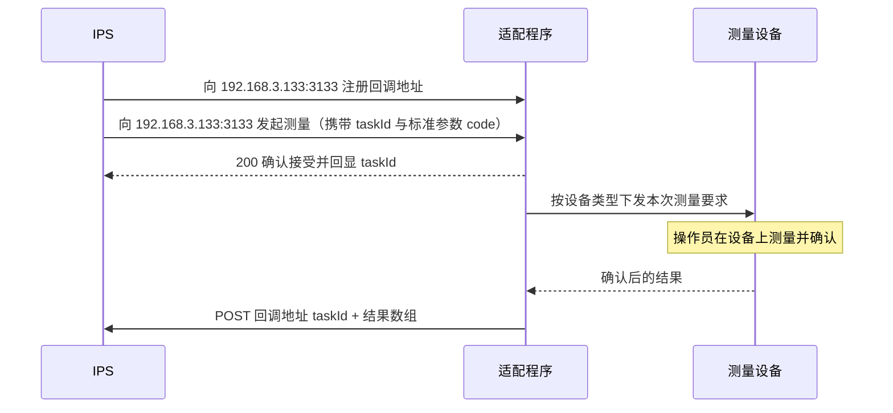

# 面向 IPS 的设备测量接口


| 项    | 内容                               |
| ---- | -------------------------------- |
| 文档版本 | v1.0                             |
| 日期   | 2026-10-10                       |
| 读者   | IPS、测量工位适配程序                     |
| 部署位置 | 测量工位 PC 上的无界面适配程序                |
| 监听端口 | 3133（各工位机固定，不随工位变化）              |
| 本期范围 | 回调地址注册、发起测量、结果回调、健康检查、调试日志查询     |
| 参数标准 | 见《标准测量参数》。我方维护，以文档发给 IPS，不提供注册接口 |


IPS 直接向测量工位上的适配程序发起测量，不经过故检修理线管理系统，也不经过工位业务客户端。适配程序本期没有界面。操作员在设备本体上完成测量并确认，程序拿到确认后的结果，再按已注册的回调地址把结果交回 IPS。

本期约定五种设备。接口里的设备类型只用下表的英文 `deviceType`，不写品牌和型号。换品牌、换型号时，`deviceType` 不变；工位机内部把设备原始参数重新映射到《标准测量参数》，该映射不提供给 IPS。

---

## 设备类型约定

名称与 `deviceType` 固定使用。发起测量和回调里的设备类型编码都取自下表，不自造，也不用中文名称代替。每种设备下有哪些参数、参数叫什么、是什么类型，以《标准测量参数》为准。该文档由我方维护并发给 IPS，不提供注册或修改接口。


| 名称        | deviceType           |
| --------- | -------------------- |
| 内窥镜       | `endoscope`          |
| 手持式三坐标测量仪 | `handheld_cmm`       |
| 数字测量千分尺   | `digital_micrometer` |
| 拍照相机      | `camera`             |
| 挠度工装测量仪   | `deflection_gauge`   |


---

## 1. 上下游关系

```text
IPS
  │  按自己的绑定表选定工位机 IP（例如故检工位 → 192.168.3.133）
  │  ① 向该 IP 的 3133 端口注册结果回调地址（这台机器只保留一个，再次调用覆盖）
  │  ② 向该 IP 的 3133 端口发起测量（带上 IPS 生成的 taskId，参数 code 取自《标准测量参数》）
  │  ◀ 立即确认接受，回显 taskId
  ▼
该工位机 · 无界面适配程序
  │  用内部映射把标准参数对应到这台机器上的设备参数，再调用本机驱动
  ▼
这台工位机上的物理设备（内窥镜 / 手持式三坐标测量仪 / 数字测量千分尺 / 拍照相机 / 挠度工装测量仪）
  │  操作员在设备上测量并确认
  ▼
适配程序  ──④ POST 已注册的回调地址──▶  IPS
            携带 taskId 与测量结果
```

三条边界：

1. **IPS 只认《标准测量参数》里的设备类型编码和参数编码。** 请求正文里写 `handheld_cmm` 这类 `deviceType`，不写中文名称、品牌、型号、串口，也不写工位机 IP。工位机 IP 不放进 JSON，它就是这次 HTTP 请求的目标地址。
2. **标准测量参数由我方维护，以文档发给 IPS。** 不提供注册、查询或更新该标准的接口。工位机内部另有一份映射，把这台机器上设备的原始参数对应到标准参数。映射只在工位机上维护，不出现在本接口中，也不发给 IPS。
3. **工位机和 IP 的绑定由 IPS 自己维护。** 不同工位机（比如 大件故检 和 小件故检）各有一个 IP。IPS 保存「哪个工位的机器用哪个 IP」，需要测哪台工位上的设备，就把注册回调和发起测量发到那台工位机的 IP。本程序不提供工位目录，也不接收工位与 IP 的登记。

---

## 2. 交互

和 IPS 的业务接口是注册回调地址，以及发起测量。另外提供健康检查和调试日志，供 IPS 确认程序是否在工作、对接时查看最近记录。标准测量参数不在接口里注册。测量结果仍只通过回调交付，日志不能代替回调。

### 2.1 注册回调

向目标工位机注册结果回调地址。这一台工位机只保留一个地址。再次调用直接覆盖上一次，不保留历史。该地址只用于「测量有了最终结果」这一件事。进行中的状态不推送。

### 2.2 发起段

IPS 先按自己维护的「工位 → 工位机 IP」选定目标机器，再调用该 IP 的 3133 端口。无论设备是手持式三坐标、拍照相机还是数字测量千分尺，无论这次测 1 个参数还是多个参数，都调用同一个发起接口。参数一律放在数组里。`deviceType` 和参数 `code` 取自《标准测量参数》。

发起接口立即返回，不等待测量结束。`taskId` 由 IPS 生成，放在发起请求里。工位机不落盘这笔任务，只把 `taskId` 和本次测量内容临时放在内存中，测量结束后随回调原样交回 IPS，然后从内存清掉。

测量结束（成功或失败）后，适配程序向已注册的回调地址 POST 一次。本期不提供按 `taskId` 查询或轮询测量结果的接口。成功和失败都会写入本机调试日志，IPS 可按第 8 节查看最近记录。

数字测量千分尺这类可以马上读到一个数的设备，同样走这条异步路径：发起接口只确认接受，读数并经操作员在设备上确认之后再回调，回调中带回 IPS 传入的 `taskId`。




---

## 3. 通用约定

### 3.1 地址：工位、工位机、IP 由 IPS 维护

适配程序安装在工位机上，监听这台机器自己的 IP。不同工位机的 IP 不同。设备接在哪台工位机上，IPS 就通过那台工位机的 IP 访问本程序。

IPS 自己维护一张绑定表，至少包含三列：工位、工位机 IP、这台机器上有哪些设备。本程序不知道自己被称作哪一个工位，也不提供查询或登记这张表的接口。IP 变更、设备换到另一台工位机时，IPS 改自己的绑定表，之后把请求发到新 IP。请求 JSON 里仍然不写 IP。

故检工位的工位机 IP 假设为 `192.168.3.133` 时，IPS 的绑定是：


| 工位   | 工位机 IP        | 这台工位机上的设备                          |
| ---- | ------------- | ---------------------------------- |
| 故检工位 | 192.168.3.133 | 内窥镜、手持式三坐标测量仪、数字测量千分尺、拍照相机、挠度工装测量仪 |


IPS 访问工位机的 HTTP 端口固定为 **3133**，各工位机相同，不随工位变化，也不写进绑定表。测量这台工位上的任一设备，根地址都是：

```text
http://192.168.3.133:3133/api/measurement
```

向故检工位发起一次手持式三坐标测量，就是：

```http
POST http://192.168.3.133:3133/api/measurement/tasks
```

```json
{
  "taskId": "018f1a2b-3c4d-7e5f-8a9b-0c1d2e3f4a5b",
  "deviceType": "handheld_cmm",
  "params": [
    { "code": "inner_diameter" },
    { "code": "roundness" },
    { "code": "cylindricity" }
  ],
  "context": { "bizRef": "L5-142.1.1" }
}
```

`taskId` 由 IPS 在发起前生成。换测同一台工位机上的数字测量千分尺时，IP 和端口不变，只换 `taskId`、`deviceType` 和 `params`。换到另一台工位机时，只改 IP，端口仍是 3133，路径和报文字段不变。

回调地址写在被请求的那一台工位机上。`192.168.3.133` 上登记的回调不会出现在其他 IP 上。IPS 每接入一台工位机，都向该 IP 的 3133 端口注册一次回调。标准测量参数由我方随程序部署到各工位机，不由 IPS 按机器注册。多台工位机通常注册同一个回调地址，结果都回到 IPS 的同一入口。`taskId` 由 IPS 生成并随请求传入，工位机只在内存里暂存，回调时原样带回；IPS 用这个 `taskId` 区分是哪一笔测量，用自己的 `context` 区分是哪一个工位、哪一张工卡。测量任务本身不落盘。

一台工位机上，每种设备类型对应一台物理设备。选工位靠 IP，选设备靠 `deviceType`。

### 3.2 报文

- 编码：UTF-8
- `Content-Type: application/json`
- 时间：ISO 8601，带时区偏移，例如 `2026-10-10T13:05:00+08:00`
- 本期不鉴权。内网调用，请求不携带认证头，适配程序也不校验调用方身份

### 3.3 成功与失败

回调注册接口和发起接口：能立即判定的错误直接用 HTTP 状态码返回，任务不进入内存。已经接受的任务，后续成败只走回调。

错误正文：

```json
{
  "code": "PARAM_UNKNOWN",
  "message": "手持式三坐标测量仪的标准测量参数中不存在 roundness"
}
```


| HTTP | 含义           |
| ---- | ------------ |
| 200  | 成功           |
| 400  | 报文不符合本文约定    |
| 409  | 该设备类型已有未完成任务 |
| 500  | 适配程序内部错误     |


### 3.4 任务号

`taskId` 由 IPS 生成，在发起测量时传入，例如 `018f1a2b-3c4d-7e5f-8a9b-0c1d2e3f4a5b`。工位机不解析、不改写，只要求它是非空字符串。接受后放进内存，回调报文里原样带回，回调结束即从内存删除。工位机不把任务号和测量结果写入磁盘。

工位机进程退出后，内存中尚未回调的任务随之消失，不会补发。IPS 按自己持有的 `taskId` 决定是否重新发起。

同一设备类型同时只允许一个未完成任务。已有未完成任务时，新的发起请求返回 `409`，错误码 `DEVICE_BUSY`。内存中已有相同 `taskId` 时返回 `409`，错误码 `TASK_DUPLICATED`。

---

## 4. 注册结果回调地址

每台工位机只保留一个回调地址。测量得到最终结果时，这台机器上的适配程序向该地址 POST。再次向同一 IP 注册即覆盖原地址，立即对这台机器上之后完成的任务生效。已经发出、尚未收到 HTTP 成功的回调，仍发往发出那次时使用的地址。其他工位机上的回调地址不受影响。

### 4.1 覆盖写入

```http
PUT http://192.168.3.133:3133/api/measurement/callback
```

请求：

```json
{
  "callbackUrl": "http://ips.intra/api/measurement/result"
}
```


| 字段          | 类型     | 必填  | 说明                            |
| ----------- | ------ | --- | ----------------------------- |
| callbackUrl | string | 是   | 非空字符串。原样保存。不校验 URL 格式，不探测能否连通 |


成功 `200`：

```json
{
  "callbackUrl": "http://ips.intra/api/measurement/result",
  "updatedAt": "2026-10-10T13:00:00+08:00"
}
```

`callbackUrl` 缺失或为空字符串时返回 `400`，错误码 `CALLBACK_URL_EMPTY`。除此之外一律覆盖保存。地址写错时，测量仍会执行，但结果送不到 IPS。本期没有补拉接口，注册后应由 IPS 自己用一笔试验任务确认回调可达。

### 4.2 读取当前地址

```http
GET /api/measurement/callback
```

已注册时 `200`，正文与覆盖写入的成功响应相同。尚未注册时 `200`，`callbackUrl` 为 `null`：

```json
{
  "callbackUrl": null,
  "updatedAt": null
}
```

---

## 5. 发起测量

```http
POST http://{工位机IP}:3133/api/measurement/tasks
```

一次请求测量一种设备类型下的一组参数。一个参数、多个参数使用同一报文，参数放在 `params` 数组中。`taskId` 由 IPS 生成后放入请求。

### 5.1 请求

```json
{
  "taskId": "018f1a2b-3c4d-7e5f-8a9b-0c1d2e3f4a5b",
  "deviceType": "handheld_cmm",
  "params": [
    {
      "code": "inner_diameter",
      "requirement": { "nominal": 50.0, "upper": 0.02, "lower": -0.02 }
    },
    {
      "code": "roundness",
      "requirement": { "upper": 0.015 }
    },
    {
      "code": "cylindricity",
      "requirement": { "upper": 0.02 }
    }
  ],
  "context": {
    "bizRef": "L5-142.1.1"
  }
}
```


| 字段                   | 类型     | 必填  | 说明                                    |
| -------------------- | ------ | --- | ------------------------------------- |
| taskId               | string | 是   | IPS 生成的任务号。非空即可。工位机原样暂存于内存，并在回调中原样带回  |
| deviceType           | string | 是   | 设备类型编码，必须是《标准测量参数》中的 `deviceType`     |
| params               | array  | 是   | 本次要测的参数，至少 1 项。顺序即结果回传顺序              |
| params[].code        | string | 是   | 参数编码，必须属于该设备在《标准测量参数》中的参数             |
| params[].requirement | object | 否   | 本次测量要求。适配程序不解释其字段，原样交给本机驱动，并在回调里原样带回  |
| context              | object | 否   | IPS 自用的业务信息，如作动筒内径、工卡。适配程序不解释、不保存，回调时原样带回。没有明确测量目标时可以不传。建议不超过 8KB |


`requirement` 的字段由 IPS 自定，例如公称值、上偏差、下偏差、工艺说明。标准参数增加时，我方发布《标准测量参数》新版本，发起接口本身不变，请求里多放一项即可。

可以只请求该设备标准参数中的一部分。不能请求《标准测量参数》里没有的编码。同一请求里 `code` 不可重复。

### 5.2 成功响应

HTTP `200`。此时任务已被接受并放入内存，测量尚未完成。响应中的 `taskId` 与请求相同。

```json
{
  "taskId": "018f1a2b-3c4d-7e5f-8a9b-0c1d2e3f4a5b",
  "deviceType": "handheld_cmm",
  "acceptedAt": "2026-10-10T13:05:00+08:00"
}
```

### 5.3 接受前就会拒绝的情况

下列情况不接受任务，不放入内存。IPS 修正后重新发起，沿用或更换自己的 `taskId` 均可。


| HTTP | code                    | 条件                       |
| ---- | ----------------------- | ------------------------ |
| 400  | TASK_ID_EMPTY           | `taskId` 缺失或为空字符串        |
| 400  | CALLBACK_NOT_REGISTERED | 还没有回调地址                  |
| 400  | DEVICE_TYPE_UNKNOWN     | `deviceType` 不在《标准测量参数》中 |
| 400  | DEVICE_TYPE_UNSUPPORTED | 标准里有该类型，本机没有驱动或内部映射      |
| 400  | PARAMS_EMPTY            | `params` 缺失或为空数组         |
| 400  | PARAM_UNKNOWN           | 某个 `code` 不属于该设备的标准测量参数  |
| 400  | PARAM_DUPLICATED        | 同一请求中 `code` 重复          |
| 400  | PARAM_UNSUPPORTED       | 参数已在标准中，本机映射还不能采集该编码     |
| 409  | DEVICE_BUSY             | 该设备类型仍有未完成任务             |
| 409  | TASK_DUPLICATED         | 内存中已有相同 `taskId`         |


设备暂时连不上、测量过程失败、操作员放弃、等待确认超时，都不在这里返回。任务已经接受，结果由回调给出。

---

## 6. 结果回调

适配程序在任务到达最终结果时，向当前生效的 `callbackUrl` 发起：

```http
POST {callbackUrl}
Content-Type: application/json
```

IPS 返回 HTTP `2xx` 即视为送达。正文 IPS 可自行定义，适配程序不解析。非 `2xx`、连接失败或超时，适配程序按 5 秒间隔重试，最多再试 3 次。重试报文与第一次相同。IPS 应按 `taskId` 去重，同一任务多次到达只入账一次。

4 次都失败时，适配程序从内存中丢掉这笔任务。本期不能按 `taskId` 把这份测量结果再拉回去，需要时用同一个或新的 `taskId` 重新发起。失败会留在调试日志里，便于对接时查看。

### 6.1 成功

```json
{
  "taskId": "018f1a2b-3c4d-7e5f-8a9b-0c1d2e3f4a5b",
  "deviceType": "handheld_cmm",
  "standardRevision": "2026-10-10",
  "status": "completed",
  "acceptedAt": "2026-10-10T13:05:00+08:00",
  "completedAt": "2026-10-10T13:27:41+08:00",
  "context": {
    "bizRef": "L5-142.1.1"
  },
  "results": [
    {
      "code": "inner_diameter",
      "name": "内径",
      "valueType": "number",
      "unit": "mm",
      "value": 49.998,
      "requirement": { "nominal": 50.0, "upper": 0.02, "lower": -0.02 }
    },
    {
      "code": "roundness",
      "name": "圆度",
      "valueType": "number",
      "unit": "mm",
      "value": 0.008,
      "requirement": { "upper": 0.015 }
    },
    {
      "code": "cylindricity",
      "name": "圆柱度",
      "valueType": "number",
      "unit": "mm",
      "value": 0.011,
      "requirement": { "upper": 0.02 }
    }
  ],
  "error": null
}
```

`results` 的顺序与发起请求中的 `params` 一致，且与之等长。`requirement` 与请求中该项一致；请求里没有则回 `null`。

### 6.2 失败

测量未能给出可用结果时同样回调一次。`status` 为 `failed`，`results` 为 `null`。

```json
{
  "taskId": "018f1a2b-3c4d-7e5f-8a9b-0c1d2e3f4a5b",
  "deviceType": "handheld_cmm",
  "standardRevision": "2026-10-10",
  "status": "failed",
  "acceptedAt": "2026-10-10T13:05:00+08:00",
  "completedAt": "2026-10-10T13:35:00+08:00",
  "context": {
    "bizRef": "L5-142.1.1"
  },
  "results": null,
  "error": {
    "code": "TIMEOUT",
    "message": "等待操作员在设备上确认结果超时"
  }
}
```


| error.code          | 含义                  |
| ------------------- | ------------------- |
| DEVICE_NOT_READY    | 接受任务后设备未能连通         |
| DEVICE_DISCONNECTED | 测量过程中设备断开           |
| MEASUREMENT_FAILED  | 设备返回失败，或确认前测量被放弃    |
| TIMEOUT             | 在本机配置的等待时限内没有得到确认结果 |
| INTERNAL_ERROR      | 适配程序内部错误            |


等待时限配在适配程序本机，不由 IPS 在请求里传入。

### 6.3 回调字段


| 字段               | 类型            | 说明                                |
| ---------------- | ------------- | --------------------------------- |
| taskId           | string        | IPS 发起时传入的任务号，原样带回                |
| deviceType       | string        | 与请求一致                             |
| standardRevision | string        | 任务接受时《标准测量参数》的文档版本                |
| status           | string        | `completed` 或 `failed`            |
| acceptedAt       | string        | 任务接受时间                            |
| completedAt      | string        | 得到最终结果的时间                         |
| context          | object / null | 请求中的 `context` 原样带回               |
| results          | array / null  | 成功时为结果数组；失败时为 `null`              |
| error            | object / null | 成功时为 `null`；失败时含 `code`、`message` |


### 6.4 结果项


| 字段          | 类型            | 说明                       |
| ----------- | ------------- | ------------------------ |
| code        | string        | 参数编码                     |
| name        | string        | 《标准测量参数》中的名称             |
| valueType   | string        | 与《标准测量参数》一致              |
| unit        | string / null | 《标准测量参数》中的单位，没有则为 `null` |
| value       | 见下表           | 测得值                      |
| requirement | object / null | 请求中的要求原样带回               |


`value` 由 `valueType` 决定：


| valueType | value                    |
| --------- | ------------------------ |
| number    | JSON 数字                  |
| string    | JSON 字符串                 |
| boolean   | JSON 布尔                  |
| image     | 图片对象数组，至少 1 张。一张截图也放在数组里 |


图片对象：


| 字段            | 类型     | 必填  | 说明                         |
| ------------- | ------ | --- | -------------------------- |
| mimeType      | string | 是   | 如 `image/jpeg`、`image/png` |
| fileName      | string | 是   | 文件名                        |
| contentBase64 | string | 是   | 文件内容的 Base64，不含 `data:` 前缀 |


拍照相机的全貌照片、局部照片，以及标准中其他 `image` 参数，单个结果项示例：

```json
{
  "code": "overview",
  "name": "全貌照片",
  "valueType": "image",
  "unit": null,
  "value": [
    {
      "mimeType": "image/jpeg",
      "fileName": "bore-1.jpg",
      "contentBase64": "/9j/4AAQSkZJRg..."
    }
  ],
  "requirement": null
}
```

---

## 7. 健康检查

IPS 用本接口判断这台工位机上的适配程序是否在工作。请求发到该工位机的 IP，端口仍是 3133。连不上、超时或不是 `200`，视为这台机器上的程序当前不可用。

```http
GET http://192.168.3.133:3133/api/measurement/health
```

程序正常时 `200`：

```json
{
  "status": "ok",
  "standardRevision": "2026-10-10"
}
```


| 字段               | 类型     | 说明                       |
| ---------------- | ------ | ------------------------ |
| status           | string | 固定为 `ok`。能返回本响应，即表示程序在工作 |
| standardRevision | string | 当前加载的《标准测量参数》文档版本        |


本接口不要求已经注册回调地址。健康检查本身不写入调试日志。

---

## 8. 调试日志

本接口用于 IPS 对接期间的开发调试。可以查看这台工位机上最近的测量相关记录。成功和失败都记录。它不是测量结果查询：业务结果仍只通过回调交付，日志里不包含完整测量值和图片。

```http
GET http://192.168.3.133:3133/api/measurement/logs?limit=100
```


| 参数    | 位置    | 必填  | 说明                                      |
| ----- | ----- | --- | --------------------------------------- |
| limit | query | 否   | 返回最近多少条。不传时为 100。可改为 200 等。最小 1，最大 1000 |


`limit` 小于 1、大于 1000 或不是整数时，返回 `400`，错误码 `LIMIT_OUT_OF_RANGE`。记录不足 `limit` 条时，有多少返回多少。

工位机只保留最近 **1000** 条。第 1001 条写入时丢掉最旧的一条。记录按时间从新到旧排列。

会记入日志的情况：


| outcome         | 何时写入               |
| --------------- | ------------------ |
| rejected        | 发起被拒绝，例如参数不存在、设备忙  |
| accepted        | 发起已被接受             |
| completed       | 测量完成，且回调得到 `2xx`   |
| failed          | 测量失败，且失败结果已回调给 IPS |
| callback_failed | 回调重试耗尽，结果没送到 IPS   |


成功 `200`：

```json
{
  "limit": 100,
  "count": 2,
  "retainedMax": 1000,
  "logs": [
    {
      "time": "2026-10-10T13:27:41+08:00",
      "taskId": "018f1a2b-3c4d-7e5f-8a9b-0c1d2e3f4a5b",
      "deviceType": "handheld_cmm",
      "outcome": "completed",
      "errorCode": null,
      "message": "测量完成，回调成功"
    },
    {
      "time": "2026-10-10T13:05:00+08:00",
      "taskId": "018f1a2b-3c4d-7e5f-8a9b-0c1d2e3f4a5b",
      "deviceType": "handheld_cmm",
      "outcome": "accepted",
      "errorCode": null,
      "message": "已接受"
    }
  ]
}
```


| 字段                | 类型            | 说明                           |
| ----------------- | ------------- | ---------------------------- |
| limit             | number        | 本次实际采用的条数上限                  |
| count             | number        | 本次返回的条数                      |
| retainedMax       | number        | 固定为 1000，本机最多保留的条数           |
| logs              | array         | 日志数组，新的在前                    |
| logs[].time       | string        | 写入时间                         |
| logs[].taskId     | string / null | IPS 传入的任务号。请求里没有任务号时为 `null` |
| logs[].deviceType | string / null | 设备类型。请求里无法识别时为 `null`        |
| logs[].outcome    | string        | 上表中的取值                       |
| logs[].errorCode  | string / null | 拒绝或失败时的错误码，没有则为 `null`       |
| logs[].message    | string        | 简短说明                         |


要看最近 200 条时：

```http
GET http://192.168.3.133:3133/api/measurement/logs?limit=200
```

---

## 9. 五种设备怎么落在同一接口上

发起报文和回调报文的形状不变。差异只在《标准测量参数》里的参数个数和 `valueType`。


| deviceType         | 名称        | 本期参数示例                        | 现场过程                                              |
| ------------------ | --------- | ----------------------------- | ------------------------------------------------- |
| endoscope          | 内窥镜       | 观测结论、缺陷位置、内窥图像                  | 确认后的文字与图片放在同一次回调的 `results` 里                     |
| handheld_cmm       | 手持式三坐标测量仪 | 内径、圆度、圆柱度、导向段磨损量、同轴度            | 操作员在仪器上按要求采点，确认后一次回调本次请求的参数                       |
| digital_micrometer | 数字测量千分尺   | 外径、长度、厚度                        | 操作员在千分尺上确认读数。发起接口只确认接受，读数走回调，并带回 IPS 传入的 `taskId` |
| camera             | 拍照相机      | 全貌照片、局部照片、拍摄说明                  | 操作员拍摄并确认后，照片放在回调的 `value` 数组里                     |
| deflection_gauge   | 挠度工装测量仪   | 测量跨距、挠度、残余挠度                    | 确认后一次回调本次请求的参数                                    |


编码、名称和参数以《标准测量参数》为准。数字测量千分尺发起示例：

```json
{
  "taskId": "018f1a2b-3c4d-7e5f-8a9b-0c1d2e3f4a5c",
  "deviceType": "digital_micrometer",
  "params": [
    { "code": "outer_diameter", "requirement": { "nominal": 24.2, "lower": 22.0 } }
  ],
  "context": { "bizRef": "L5-142.2.1" }
}
```

对应回调中的结果项：

```json
{
  "code": "outer_diameter",
  "name": "外径",
  "valueType": "number",
  "unit": "mm",
  "value": 24.20,
  "requirement": { "nominal": 24.2, "lower": 22.0 }
}
```

---

## 10. 参数变化时怎么处理

接口路径和报文字段不变。IPS 不调用接口修改参数。我方修订《标准测量参数》并发给 IPS，同时更新工位机上的标准参数和内部映射。IPS 按新文档里的 `code` 发起。已经接受、尚未回调的任务，仍按接受时的那一版参数回传，`standardRevision` 标明版本。

例如日后手持式三坐标增加椭圆度，新版本文档会把 `version` 改为新版本号，并增加 `ellipticity`（number，mm）。此后的请求在 `params` 中加入 `{ "code": "ellipticity", "requirement": { "upper": 0.02 } }`。内窥镜日后增加录像时，文档中会增加 `video`，需要录像的测量再把该项放入 `params`。

---

## 11. 适配程序本机职责

下列行为不对外提供接口。

1. 收到发起请求并通过第 5.3 节的检查后，把 IPS 传入的 `taskId` 和本次测量放进内存，立即回显 `taskId`。任务不写入磁盘。
2. 按内部映射，把请求中的标准参数 `code` 对应到这台工位机上设备的原始参数，再交给该设备的驱动。映射由我方维护在工位机上，内容是「设备原始参数 → 标准测量参数」。IPS 不登记、不读取这份映射。
3. 本期程序没有界面。操作员在设备自己的面板或既有操作方式上完成测量并确认。程序只取确认后的那一组结果，再按标准参数编码组装回调。
4. 结果齐套后组回调报文并 POST，报文中的 `taskId` 与内存中 IPS 传入的值相同。失败、断开、超时同样只回调一次，`status` 为 `failed`。
5. 回调得到 `2xx`，或重试耗尽之后，从内存删除这笔任务，并写入一条调试日志。该设备类型随后可以接受下一笔。发起被拒绝时同样写一条日志。日志只保留最近 1000 条。
6. 品牌、型号、串口、网口、协议模板只存在于本机驱动和内部映射中。更换同类型设备的品牌或型号时，我方改映射和驱动，《标准测量参数》和 IPS 接口不变。标准里已有、但本机映射还不能采集的参数，发起时返回 `PARAM_UNSUPPORTED`，任务不进入内存。映射接上该参数之后，同一发起报文即可使用。

---

## 12. 本期不包括的能力

- 不提供标准测量参数的注册、查询或更新接口。参数以《标准测量参数》文档发给 IPS
- 不向 IPS 提供工位机内部映射
- 不提供按 `taskId` 查询测量结果。调试日志只用于对接调试，不能代替回调
- 不提供测量过程中的状态推送，回调只有最终这一次
- 不提供取消任务的接口。未完成任务由设备侧结束，或等到本机超时后以 `TIMEOUT` 回调
- 不鉴权，不签名，不加密
- 不校验回调地址能否连通
- 不在接口中指定品牌、型号、设备通信口。HTTP 端口固定为 3133
- 工位机不持久化测量任务，`taskId` 只在内存中保留到回调结束
- 适配程序本期不做操作界面

